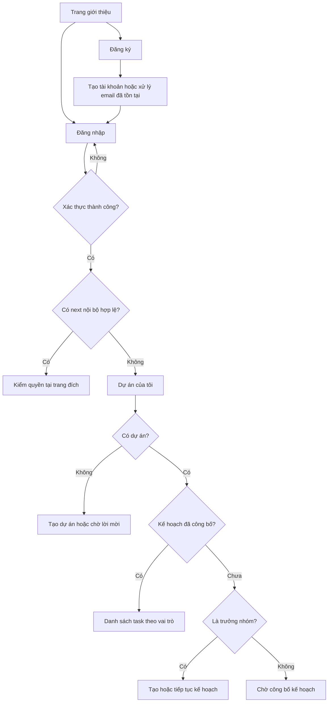

# Kế hoạch triển khai đăng ký, đăng nhập, phân quyền và phân luồng — TeamFlow AI

Ngày lập: 07/11/2026. Trạng thái: **M1 & M2 đã hoàn thành, vượt qua 40/40 tests và build production thành công**.

## 1. Mục tiêu và cách sử dụng tài liệu

Chuyển từ việc chọn tài khoản demo TV1/TV2/TV3 sang tài khoản cá nhân dùng email và mật khẩu. Sau khi đăng nhập, người dùng chỉ thấy dự án mình tham gia, được đưa đến màn hình phù hợp và chỉ thực hiện thao tác đúng quyền trong từng dự án.

Ưu tiên triển khai hoàn chỉnh đăng ký, đăng nhập, đăng xuất và session trước. Các mốc tiếp theo bổ sung phân luồng dự án, xác minh email, khôi phục mật khẩu và mời thành viên. Không đánh dấu hoàn thành chỉ vì form đã hiển thị.

Tài liệu này cụ thể hóa yêu cầu mới của người dùng, mở rộng phạm vi xác thực demo trong MVP gốc. Chỉ hai trang `/register`, `/login` được thêm trong đợt đầu; các trang auth bổ sung được liệt kê tại đợt 3. Các giới hạn nghiệp vụ planning/tracking/delivery vẫn giữ nguyên.

Đọc cùng:

- [Quy tắc repository](../AGENTS.md), [quy tắc dự án](PROJECT_RULES.md), [contracts](CONTRACTS.md).
- [Bàn giao khung](SCAFFOLD_HANDOFF.md), [TV1](TV1_HANDOFF.md), [TV2](TV2_HANDOFF.md).
- [UI rules](ui/UI_RULES.md), [design system](ui/DESIGN_SYSTEM.md), [sitemap](ui/SITEMAP_AND_FLOWS.md), [page specs](ui/PAGE_SPECS.md), [component states](ui/COMPONENT_STATES.md), [UI acceptance](ui/UI_ACCEPTANCE_CHECKLIST.md).

Các phần mô tả scaffold hoặc phiên tài liệu cũ không phải bằng chứng tính năng hiện tại đã hoặc chưa hoạt động. Khi bắt đầu triển khai phải đọc lại code, trạng thái Git và tài liệu bàn giao mới nhất.

## 2. Hiện trạng đã rà trong repository

| Thành phần | Hiện trạng | Hướng xử lý |
|---|---|---|
| Stack | Next.js 16, React 19, TypeScript strict, Tailwind v4, Drizzle, Neon | Giữ stack hiện tại |
| `src/server/auth/session.ts` | Tìm session qua hash token, kiểm hạn, đọc membership; có helper tạo session demo | Tách cơ chế tạo session dùng chung khỏi lựa chọn demo |
| `src/server/auth/demo-session.ts` | Thiết lập cookie và phiên demo; có logic trùng với helper session | Dùng chung một service session; adapter demo chỉ còn ánh xạ tài khoản |
| `src/server/auth/index.ts` | `requireSession()` và `authorizationProvider` được các module sử dụng | Giữ điểm tích hợp, đổi thông báo không còn phụ thuộc demo |
| `src/server/auth/access.ts` | Đọc quyền từ `ProjectMember` trong DB | Tiếp tục dùng làm nguồn quyền |
| `users` | Có `id`, `displayName`, `createdAt`; chưa có email/mật khẩu | Bổ sung email và thông tin xác thực bằng migration mới |
| `sessions` | Có `tokenHash`, `userId`, `expiresAt` | Giữ session lưu DB, cookie chứa token ngẫu nhiên |
| Contract session | `{ user: User, memberships: ProjectMember[] }` | Giữ shape để planning/tracking/delivery tiếp tục dùng |
| `/app` | Có form chọn TV1/TV2/TV3 | Chuyển thành trang dự án sau đăng nhập |
| App layout | Có shell, chưa phải nơi đảm bảo đầy đủ mọi kiểm tra quyền | Thêm kiểm tra session ở server; kiểm quyền tại service cho mỗi thao tác |
| `GET /api/users` và `listDemoUsers()` | Danh sách giới hạn ba tài khoản demo | Bổ sung read model người dùng được phép nhìn thấy, không mở danh bạ toàn hệ thống |
| Wizard dự án | Nhận danh sách `users`, mặc định chọn các user được truyền vào | Luôn có chính người đang đăng nhập; không tự thêm mọi tài khoản vào dự án |
| `ProjectMember` | `role: leader/member`, `canAccept` | Giữ enum và cách cấp quyền theo dự án |

**Phụ thuộc quan trọng:** tài khoản mới phải tạo được dự án với chính mình dù hệ thống chưa có chức năng mời thành viên. Không được để wizard vẫn chỉ hiện ba tài khoản demo hoặc bỏ sót người tạo dự án.

## 3. Phạm vi theo đợt

| Đợt | Nội dung bắt buộc | Kết quả nghiệm thu |
|---|---|---|
| M1 — Tài khoản và session | AUTH-01 đến AUTH-06, AUTH-09 phần chuyển đổi demo | Đăng ký → đăng nhập → giữ phiên → đăng xuất; tài khoản thật vào được `/app` |
| M2 — Quyền và điều hướng | AUTH-07, AUTH-08, AUTH-10, tích hợp AUTH-09 | Tạo dự án, xem đúng dữ liệu, chặn sai quyền và có điều hướng theo trạng thái kế hoạch |
| M3 — Hoàn thiện tài khoản trước public | AUTH-11, AUTH-12, gửi email thật | Xác minh email, quên/đặt lại mật khẩu, chống dùng lại token |
| M4 — Tham gia dự án bằng lời mời | AUTH-13 | Mời đúng email đã xác minh, nhận lời mời, có membership đúng dự án |

M1–M2 dành cho phát triển/kiểm thử nội bộ có kiểm soát. Đăng nhập bằng email/mật khẩu chỉ chứng minh người dùng biết mật khẩu tài khoản, chưa chứng minh sở hữu hộp thư. Không dùng email chưa xác minh để tự động nhận lời mời, gắn vào tài khoản cũ hoặc nhận dữ liệu dự án. Chỉ mở đăng ký công khai sau khi M3 và các kiểm tra phát hành tương ứng đạt.

Không đưa vào kế hoạch này: OAuth Google/GitHub, SSO, MFA, billing, trang quản trị hệ thống, chuyển quyền trưởng nhóm, xóa tài khoản, xóa thành viên hoặc chỉnh lại task đã công bố. Đây không phải yêu cầu triển khai thêm các chức năng đó.

## 4. Quyết định nghiệp vụ và kỹ thuật cho bản đầu

### 4.1. Danh tính và vai trò

1. Đăng ký tạo một `User`; không tạo role toàn cục và không tạo membership mặc định.
2. Form/API đăng ký không có `role`, `canAccept`, `projectId`, `userId` hoặc lựa chọn TV1/TV2/TV3.
3. Người có session hợp lệ được tạo dự án. Server tự thêm người tạo làm `leader`, `canAccept=true`.
4. `leader` và `member` chỉ có ý nghĩa trong dự án tương ứng. Một User có thể có vai trò khác nhau ở các dự án.
5. Người nghiệm thu vẫn là leader hoặc member có `canAccept=true`; không thêm enum `reviewer`.
6. Người được giao task được xác định bằng `assigneeMemberId`, không bằng chức danh trong giao diện.
7. Tài khoản mới chưa có dự án thấy empty state, không được tự nhận dự án demo hoặc dự án người khác.
8. Chưa có session trả API 401; đã có session nhưng không có membership trả 404 chung; có membership nhưng thiếu quyền thao tác trả 403.

### 4.2. Lựa chọn auth và password

Giữ `requireSession()`, session DB và lớp kiểm quyền hiện tại làm giao diện tích hợp. Trong M1 không thay đồng thời toàn bộ auth bằng một provider ngoài, không chuyển dữ liệu session sang localStorage và không phát JWT có role để thay quyền DB.

Dùng thư viện băm mật khẩu được duy trì, hỗ trợ Argon2id; không tự viết thuật toán. Task nền tảng phải kiểm chứng gói được chọn trên Node 24, Windows phát triển và môi trường deploy trước khi chốt dependency. Mốc cấu hình đề xuất: Argon2id, memory tối thiểu 19 MiB, iterations 2, parallelism 1; benchmark và tăng chi phí nếu hạ tầng cho phép. Salt riêng được thư viện sinh và lưu trong chuỗi hash. Nếu không thể chạy Argon2id, TV2 ghi rõ phương án scrypt, thông số và bằng chứng kiểm thử trước khi đổi implementation; không tự hạ sang SHA-256 cho mật khẩu. Tham chiếu: [OWASP Password Storage](https://cheatsheetseries.owasp.org/cheatsheets/Password_Storage_Cheat_Sheet.html).

Đây là quyết định thích nghi với nền code hiện có. [Next.js Authentication](https://nextjs.org/docs/app/guides/authentication) khuyến nghị dùng thư viện auth để giảm phần tự quản lý; nếu sau này chọn thư viện đầy đủ thì phải có kế hoạch adapter/migration riêng, bảo toàn ID và contract nghiệp vụ.

### 4.3. Quy tắc input dùng chung client/server

| Trường | Quy tắc |
|---|---|
| `displayName` | Trim đầu/cuối, 2–100 ký tự Unicode; không nhận chuỗi toàn khoảng trắng; render dạng text |
| `email` | Trim đầu/cuối, kiểm cấu trúc, tối đa 254 ký tự; bản đầu hỗ trợ địa chỉ ASCII và thống nhất lowercase toàn địa chỉ làm khóa tìm kiếm |
| Chuẩn hóa email | Không bỏ dấu chấm, không bỏ phần `+tag`, không tự suy hai địa chỉ là một người |
| `password` khi đăng ký/reset | 8–128 ký tự Unicode, tối đa 512 byte UTF-8; cho phép khoảng trắng, Unicode, paste và password manager |
| Xử lý password | Không trim, không lowercase, không chuẩn hóa Unicode hoặc cắt chuỗi; so sánh qua hàm verify của thư viện |
| Xác nhận password | Chỉ phục vụ form, phải trùng chính xác; không cần gửi thêm trường này đến API |
| `password` khi đăng nhập | Chặn rỗng/quá giới hạn; không áp lại điều kiện độ dài tối thiểu của đăng ký để tránh khóa tài khoản nếu policy đổi |
| JSON | Body strict, tối đa 32 KB; từ chối trường thừa có thể giả danh tính/quyền |

Validator đếm ký tự Unicode phải thống nhất, ví dụ `Array.from(value).length`; không để client và server hiểu khác nhau về độ dài. Các mốc độ dài và cấu hình trong tài liệu là policy dự án đề xuất, không phải tuyên bố mọi thư viện đã áp dụng sẵn.

### 4.4. Cấu hình và điều kiện mở chức năng

Các biến mới dưới đây chỉ được thêm vào code và `.env.example` khi triển khai; tên và giá trị trong tài liệu là contract cấu hình đề xuất.

| Biến | Mặc định/quy tắc | Mục đích |
|---|---|---|
| `DATABASE_URL`, `DATABASE_DIRECT_URL` | Giữ cấu hình hiện có, server-only | Runtime và migration đúng môi trường |
| `APP_ORIGIN` | Bắt buộc cấu hình URL origin, không có path; test dùng origin test riêng | So khớp origin mutation và tạo URL callback an toàn |
| `AUTH_REGISTRATION_MODE` | `disabled` mặc định; cho phép `internal` ở development/test; `public` từ M3 | Không vô tình mở đăng ký khi mới deploy M1 |
| `AUTH_REQUIRE_EMAIL_VERIFICATION` | `true` khi public; M1–M2 chỉ được `false` ở development/test | Gate tài khoản trước session nghiệp vụ |
| `AUTH_RATE_LIMIT_SECRET` | Bắt buộc secret ngẫu nhiên tối thiểu 32 byte, ổn định giữa các instance | HMAC scope limiter; không dùng chung với token/email key |
| `ENABLE_DEMO_AUTH` | `false`; production từ chối `true` | Giới hạn adapter demo |
| Cấu hình dịch vụ email | Chưa cần M1–M2; bắt buộc M3 | Gửi verify/reset thật, không giả thành công |

Service khởi động/request phải từ chối tổ hợp cấu hình không hợp lệ, ví dụ production + demo, public registration + bỏ xác minh, hoặc thiếu limiter secret. `internal` không phải một role mới; nó giới hạn chức năng đang phát triển ở môi trường development/test. Không dùng biến `NEXT_PUBLIC_*` cho secret. Đăng ký tắt trả 403 `REGISTRATION_DISABLED` và UI giải thích ngắn gọn, không hiển thị form có nút tạo tài khoản không hoạt động.

## 5. Đặc tả từng chức năng M1–M2

### AUTH-01 — Đăng ký tài khoản

**Owner:** TV1 form/UI; TV2 API/service/DB. **Ưu tiên:** P0, M1.

**Màn hình:** `/register`, hiển thị tên, email, mật khẩu, xác nhận mật khẩu; nút hiện/ẩn mật khẩu; liên kết đăng nhập; một CTA chính “Tạo tài khoản”. Không có chọn vai trò.

**Luồng xử lý:**

1. Nếu đã đăng nhập, chuyển về `/app`, không tạo thêm tài khoản từ phiên đang dùng.
2. Client kiểm tra input và hiển thị lỗi cạnh trường; server luôn kiểm tra lại.
3. Server kiểm cùng origin, loại nội dung, giới hạn body và rate limit trước khi băm.
4. Chuẩn hóa email, băm mật khẩu bên ngoài transaction để không giữ khóa DB khi tính hash.
5. Tạo `users` và `user_credentials` trong cùng transaction. ID/thời gian do server cấp.
6. Unique constraint xử lý race hai request cùng email; không chỉ kiểm tra tồn tại rồi tin kết quả đó.
7. Không tạo session tự động, không tạo ProjectMember, không nhận role từ body.
8. Với email hợp lệ mới hoặc đã tồn tại, trả cùng HTTP 202 và cùng thông báo chung: “Yêu cầu đăng ký đã được xử lý. Bạn có thể đăng nhập bằng thông tin tài khoản của mình.” Không trả `userId`, token hay cờ email tồn tại. Tài khoản đã tồn tại không bị đổi tên/mật khẩu.
9. UI chuyển `/login?registered=1`, hiển thị đúng thông báo chung. Không đưa email/mật khẩu vào query string hoặc analytics.

**Trạng thái UI:** idle, lỗi từng trường, submitting, lỗi mạng/server, bị giới hạn, đã xử lý. Disable submit khi đang gửi; không hiển thị phần trăm. Lỗi mạng giữ input trong bộ nhớ component để người dùng sửa/thử lại; không ghi password ra storage và không hứa dữ liệu còn sau reload.

**Tiêu chí nghiệm thu:** account mới có một User và một credential; email trùng hoặc gửi đồng thời không tạo trùng; retry không ghi đè tài khoản cũ; dữ liệu trả về không có password/hash/quyền; rollback không để User không có credential do lỗi giữa transaction.

### AUTH-02 — Đăng nhập

**Owner:** TV1 UI; TV2 API/service. **Ưu tiên:** P0, M1.

**Màn hình:** `/login`; email, mật khẩu, hiện/ẩn mật khẩu, CTA “Đăng nhập”, liên kết đăng ký. Không có checkbox “Ghi nhớ” trong bản đầu.

**Luồng xử lý:**

1. Kiểm session hiện tại. Nếu còn hợp lệ, chuyển đến đường dẫn nội bộ đã kiểm tra hoặc `/app`.
2. Validate body, cùng origin và rate limit. Chuẩn hóa email cùng quy tắc đăng ký.
3. Truy vấn credential bằng email chuẩn hóa. Không tìm bằng displayName.
4. Dùng hàm verify Argon2id. Email không tồn tại vẫn đi qua một dummy hash hợp lệ đã chuẩn bị để giảm chênh lệch thời gian; không tạo dummy hash mới mỗi request.
5. Email không có credential, password sai hoặc tài khoản demo không có mật khẩu đều trả 401 `INVALID_CREDENTIALS`: “Email hoặc mật khẩu không đúng.”
6. Hợp lệ thì tạo token mới; thu hồi token đang ở cookie của trình duyệt này nếu có; insert session và revoke token cũ trong cùng transaction.
7. Sau DB commit mới set cookie. Nếu không nhận được cookie do mất kết nối, người dùng đăng nhập lại; phiên không đến được trình duyệt tự hết hạn.
8. Response giữ SessionData công khai; không trả token trong JSON. Điều hướng bằng `router.replace`, refresh dữ liệu theo tài khoản mới và xóa state riêng của tài khoản trước.

Không nhận `userId`, `role`, `memberships`, `canAccept` từ request đăng nhập. Không dùng email chưa xác minh để liên kết với danh tính cũ.

**Tiêu chí nghiệm thu:** đúng thông tin vào app; sai thông tin không tạo session; session ID thay sau đăng nhập; đăng nhập không làm đổi quyền theo dự án; không lưu password ở client storage/log.

### AUTH-03 — Duy trì và đọc session

**Owner:** TV2. **Ưu tiên:** P0, M1.

- Hợp nhất cơ chế issue/find/revoke vào một lớp session dùng chung. Demo và tài khoản thật gọi cùng primitive, không duy trì hai implementation khác nhau.
- Token ngẫu nhiên 32 byte; DB chỉ lưu SHA-256 của token. SHA-256 ở đây dành cho token có entropy cao, không dành cho mật khẩu.
- Hạn phiên cố định 8 giờ từ lúc đăng nhập, không tự gia hạn và không có “remember me” trong bản đầu.
- Cookie `teamflow_session`: `HttpOnly`, `SameSite=Lax`, `Path=/`, không đặt Domain; `Secure=true` ở production HTTPS; expiry khớp DB.
- Mỗi request cần xác thực đọc session chưa hết hạn và User còn hợp lệ. Không chỉ kiểm cookie tồn tại.
- `GET /api/session` giữ `{data:{user,memberships}}`; User công khai chỉ có `id`, `displayName`, `createdAt` qua mapper chọn trường rõ ràng.
- Email/verified status dành riêng cho chủ tài khoản, không tự thêm vào SessionData công khai hoặc mọi member response. Nếu cần hiển thị email ở M3, dùng DTO riêng đã mô tả trong contract mới.
- Đọc quyền ProjectMember hiện tại khi thao tác. Không tin bản membership cũ cache trong React, cookie hay một session object do test/client dựng.
- Response auth và dữ liệu cá nhân dùng `Cache-Control: no-store`; không dùng cache dùng chung giữa nhiều user.
- Reload hoặc mở tab mới giữ phiên còn hạn. Hết hạn/token sai/token bị thu hồi trả 401; DB không truy cập được trả 503, không giả thành “chưa đăng nhập”.

**Tiêu chí nghiệm thu:** phiên cũ/hết hạn/sai format bị từ chối; reload không mất phiên hợp lệ; không trả raw token/hash; lỗi DB hiển thị lỗi có thể thử lại, không tạo vòng lặp redirect.

### AUTH-04 — Đăng xuất và thay đổi tài khoản trên cùng trình duyệt

**Owner:** TV1 nút/shell; TV2 API. **Ưu tiên:** P0, M1.

1. Nút “Đăng xuất” có trạng thái đang xử lý và chống bấm lặp.
2. POST logout kiểm origin; đọc cookie; thu hồi đúng session hiện tại trong DB rồi xóa cookie cùng path/options.
3. Không có cookie hoặc đã đăng xuất: vẫn trả thành công để thao tác idempotent.
4. DB lỗi khi đang có token: trả 503, không thông báo “đã đăng xuất” và không coi token đã bị thu hồi; cho phép thử lại.
5. Thành công thì xóa dữ liệu riêng trong client, `replace('/login')`, refresh router.
6. Tab khác không giữ được quyền chỉ nhờ UI cũ: request tiếp theo phải 401. Có thể dùng BroadcastChannel truyền sự kiện logout, tuyệt đối không truyền token.
7. Đăng xuất phiên này không tự đăng xuất mọi thiết bị; chức năng quản lý mọi phiên nằm ngoài M1–M2.

**Tiêu chí nghiệm thu:** cookie và bản ghi session hiện tại bị thu hồi; dùng lại token cũ không đọc được API; tài khoản B trên cùng trình duyệt không thấy state/dữ liệu tài khoản A.

### AUTH-05 — Bảo vệ trang và đường dẫn quay lại

**Owner:** TV1 route/layout; TV2 helper server. **Ưu tiên:** P0, M1.

- `/`, `/login`, `/register` là public. Tất cả `/app/**` cần session.
- Server layout/page gọi helper xác thực phù hợp; API luôn tự xác thực, không phụ thuộc việc đã đi qua layout hoặc Proxy.
- Chưa đăng nhập mở `/app/...` → `/login?next=<đường dẫn nội bộ đã mã hóa>`.
- API chưa đăng nhập trả JSON 401, không redirect HTML để client còn phân loại được lỗi.
- `next` chỉ được phép là đường dẫn tương đối dưới `/app` hoặc chính `/app`, không scheme, host, `//`, backslash, control character, đường dẫn auth hoặc chuỗi mã hóa lồng để vượt allowlist. Parse/normalize đúng một chính sách dùng chung và kiểm tra pathname, không chỉ `startsWith('/app')` vì `/application` không hợp lệ.
- Không đưa `next` không hợp lệ vào `Location`, `router.push` hoặc `router.replace`; fallback `/app`.
- Sau login quay lại đường dẫn hợp lệ nhưng vẫn kiểm quyền dự án/task tại đích. `next` không cấp quyền.
- Người đã đăng nhập mở login/register được đưa về app. Redirect không được lặp giữa app và login khi session service bị lỗi.

**Tiêu chí nghiệm thu:** deep link hoạt động sau login; `https://evil.example`, `//evil.example`, `/application`, đường dẫn login tự lặp và biến thể encode bị loại.

### AUTH-06 — Validation, giới hạn đăng nhập và thông báo lỗi

**Owner:** TV2 backend/contracts; TV1 trình bày lỗi. **Ưu tiên:** P0, M1.

Thiết lập hạn mức đề xuất, điều chỉnh bằng đo tải và test, không khóa tài khoản vĩnh viễn do nhập sai:

| Operation | Scope | Hạn mức khởi điểm |
|---|---|---|
| Đăng ký | IP đã xác định từ hạ tầng tin cậy | 5 request hợp lệ/60 phút |
| Đăng nhập | Email chuẩn hóa + IP | 10 lần thử/15 phút |
| Đăng nhập | IP | 100 lần thử/15 phút |

- Counter lưu ở PostgreSQL và cập nhật atomic để hoạt động qua nhiều process/instance. Không chỉ dùng Map trong bộ nhớ server.
- V1 dùng fixed window; lưu window start + count + expiry. Chính sách và phạm vi hạn mức nằm trong cấu hình server/test, không lấy từ client.
- Khóa scope của limiter dùng HMAC với secret server để tránh lưu nguyên email/IP trong bảng limiter. Giới hạn độ dài đầu vào trước khi tính hash.
- Chỉ tin header IP từ proxy đã cấu hình; không tin trực tiếp `x-forwarded-for` tùy ý. Nếu deploy chưa xác định được nguồn IP tin cậy thì chưa đạt gate public.
- Quá hạn mức trả 429 `RATE_LIMITED`, có `Retry-After`; không thực hiện thêm hash password đắt tiền sau khi đã chặn.
- DB/limiter lỗi trả 503 để tránh bỏ qua giới hạn âm thầm.
- Cùng origin là điều kiện bắt buộc cho mutation browser; kiểm `Origin` theo public origin tin cậy phía server và loại request cross-site. Không dựa trên Host hoặc forwarded header chưa được hạ tầng tin cậy kiểm soát.
- Body sai JSON/validation trả 422, sai content type trả 415, body quá lớn trả 413; không trả chi tiết SQL/stack/provider.
- Log chỉ gồm operation, outcome, mã lỗi, request correlation ID và thời gian. Không log request body auth, password, raw token, cookie hoặc URL chứa token.
- Dọn bản ghi limiter hết hạn bằng tác vụ vận hành/manual có giới hạn; không thêm scheduler nghiệp vụ hoặc job báo cáo tuần.

Thông báo chung, chống lộ tồn tại tài khoản và login throttling tham chiếu [OWASP Authentication](https://cheatsheetseries.owasp.org/cheatsheets/Authentication_Cheat_Sheet.html). Không đưa secret vào `.env.example` hoặc Git.

### AUTH-07 — Trang dự án và điều hướng theo trạng thái kế hoạch

**Owner:** TV1 shell/CTA; TV2 P02/read model. **Ưu tiên:** P0, M2.

| Trạng thái | Nội dung/hành động |
|---|---|
| User chưa có membership | “Bạn chưa tham gia dự án nào”; CTA “Tạo dự án”; thông tin chờ trưởng nhóm mời ở mốc M4 |
| Project chưa có Plan, actor là leader | “Chưa tạo kế hoạch”; mở wizard/điểm tiếp tục dự án đã lưu, không tạo project thứ hai |
| Plan draft, actor là leader | “Tiếp tục kế hoạch”; mở P04 |
| Chưa có Plan hoặc Plan draft, actor là member | “Chờ trưởng nhóm công bố kế hoạch”; không có liên kết mở nội dung nháp |
| Plan published, actor là leader | “Mở công việc”; P05 hiển thị tổng quan và toàn bộ task dự án |
| Plan published, actor là member | “Mở công việc”; P05 ưu tiên bộ lọc “Việc của tôi”, vẫn được đọc task khác trong cùng dự án |
| Member có `canAccept` | Có thêm bộ lọc “Chờ nghiệm thu”; không tự chuyển sang task hoặc dự án khác |

- Mặc định login thành công luôn về `/app` trừ `next` hợp lệ; không tự chọn dự án đầu tiên vì có thể người dùng tham gia nhiều dự án.
- Điểm tiếp tục project chưa có Plan dùng P04 `/app/projects/:id/plan` để hiển thị trạng thái hiện tại. Nếu cần sửa đầu vào, dùng wizard hiện có `/app/projects/new?projectId=:id`: loader kiểm leader, nạp project/member đã lưu và submit update thay vì create. Không có query thì tạo mới; query sai quyền/ID trả 404; project đã có Plan quay lại P04. Trạng thái project đã lưu phải phục hồi được sau reload, không chỉ nằm trong React state.
- Quyền và trạng thái kế hoạch được tính từ dữ liệu server; có thể tạo DTO `ProjectAccessSummary` gồm `currentMemberId`, `currentRole`, `canAccept`, `planStatus`. Không thêm nội dung draft vào summary.
- DTO mới phải có Zod schema và cập nhật client cùng lượt; giữ response cũ hoạt động trong quá trình chuyển đổi bằng field tùy chọn hoặc endpoint adapter được mô tả rõ.
- Truy cập P04 trực tiếp khi là member và Plan chưa published: trả 403 có thông báo chờ công bố, không trả danh sách draft task. Không có membership: 404 chung.
- Loading, lỗi tải dữ liệu và danh sách trống là ba trạng thái khác nhau.

### AUTH-08 — Phân quyền thao tác theo dự án/task

**Owner:** TV2 helper; TV1 planning; TV3 delivery/reports. **Ưu tiên:** P0, M2.

| Thao tác | Leader | Member là assignee | Member khác | Member có `canAccept` nhưng không là assignee |
|---|---|---|---|---|
| Đọc project/task/chat/bài nộp/review/report cùng dự án | Có | Có | Có | Có |
| Đọc kế hoạch draft | Có | Không | Không | Không |
| Sửa thông tin/thành viên, tạo/sửa/publish Plan | Có, theo trạng thái cho phép | Không | Không | Không |
| Gửi chat thảo luận | Có | Có | Có | Có |
| Chat/resolve cập nhật task | Có, theo luật tracking | Có, đúng task | Không | Không |
| Nộp bài/yêu cầu AI review | Có | Có | Không | Không |
| Xác nhận `done` | Có, đủ điều kiện | Chỉ khi có `canAccept` | Không | Có, đủ điều kiện |
| Tạo báo cáo tuần | Có | Không | Không | Không |

Mọi ô “Có” vẫn phải kiểm cùng dự án, đúng entity, version và trạng thái nghiệp vụ. Ví dụ leader không được sửa task đã công bố ngoài contract hiện tại; `canAccept` không bỏ qua review, bằng chứng hoặc revision mới nhất.

UI có thể ẩn/disable thao tác nhưng API/service phải kiểm lại. Không cấp thêm quyền vì có thể đoán URL, đổi body, sửa cookie hoặc tự khai role. Mutation phải xác minh quyền hiện tại trước khi phát lại kết quả idempotency; sau khi quyền thay đổi, key cũ không trở thành đường đọc dữ liệu vượt quyền.

### AUTH-09 — Tắt demo trong luồng sử dụng thật

**Owner:** TV2 cấu hình/auth; TV1 UI/nhãn. **Ưu tiên:** P0, M1–M2.

- Khi chạy tài khoản thật, bỏ form chọn TV1/TV2/TV3 khỏi `/app` và shell. Thay bằng tên người dùng, vai trò trong dự án hiện tại và nút đăng xuất.
- `ENABLE_DEMO_AUTH=false` là mặc định. Production từ chối bật demo; kiểm cả handler cấp phiên lẫn lúc đọc phiên demo còn sót lại, không chỉ ẩn UI.
- Giữ User ID demo, membership và dữ liệu cũ; không tự đổi `demo-tv1` thành tài khoản đăng ký đầu tiên và không tự gán password chung.
- Tài khoản thật mới không tự sở hữu dự án demo. Nếu cần chuyển dữ liệu demo, lập thao tác bàn giao riêng có mapping danh tính rõ ràng; không suy từ tên/email.
- `POST /api/session` cũ chỉ phục vụ demo khi hợp lệ và được bật ở development/test; không diễn giải body `{demoAccount}` thành đăng nhập thật.
- `DELETE /api/session` cũ gọi chung primitive logout trong thời gian chuyển đổi. UI mới dùng `/api/auth/logout`.
- Giữ seed demo để regression test độc lập; seed không tạo tài khoản thật với mật khẩu mặc định.
- Session demo đang tồn tại bị từ chối trong production; việc thu hồi/dọn đúng nhóm session demo không xóa Project/Task/Submission.
- Cập nhật README, contracts và handoff tại phiên triển khai để bỏ mô tả “chọn TV1 là đăng nhập sử dụng thật”.

### AUTH-10 — Tích hợp tài khoản mới vào wizard và tên thành viên

**Owner:** TV1 wizard; TV2 truy vấn user/member. **Ưu tiên:** P0, M2.

1. Wizard luôn có chính actor trong bước thành viên, được chọn và không thể bỏ chọn.
2. Không dùng danh sách ba tài khoản demo làm danh sách người dùng thật. Không tự chọn toàn bộ users được API trả về.
3. Trước M4, tạo dự án một người là luồng hoạt động hợp lệ; nhập kỹ năng/giờ của chính mình và tiếp tục tạo Plan. Hệ thống chưa có lời mời thì UI nói rõ, không hiển thị nút giả.
4. `GET /api/users` giữ array `User` nhưng thay phạm vi từ ba tài khoản demo sang chính actor và những người có chung ít nhất một dự án với actor. Query theo membership, trả distinct, không có email/credential. Đây là read model để tra nhãn, không phải quyền thêm người vào dự án mới.
5. Wizard mặc định chỉ hiển thị self ở chế độ tài khoản thật M1–M2. M4 mới thêm người thông qua lời mời đúng policy, không tự thêm vì biết User ID.
6. Kiểm tra cả `listDemoUsers()`, page loader P03 và `loadContext()` tracking. Page loader mới truyền chính actor; tracking tiếp tục tra được tên thành viên cùng dự án thay vì hiện ID tài khoản thật.
7. `POST /api/projects/:id/members` hiện nhận `userId` chỉ được dùng theo quyền leader và policy nội bộ/test trong M1–M2. Khi mở public/M4, thêm membership người khác chỉ thông qua nhận lời mời, hoặc endpoint cũ phải được giới hạn tương ứng. Biết ID không đủ để kéo tài khoản vào một project tùy ý.
8. `canAccept` của người tạo luôn true. Member được mời mặc định false; chỉ leader cấp theo flow M4 và giới hạn trạng thái hiện hành.

Thay đổi phạm vi read model/API thành viên phải được TV1/TV2/TV3 cập nhật đồng bộ trước phát hành vì ảnh hưởng wizard, nhãn task/chat và kiểm thử cũ.

## 6. Thiết kế dữ liệu và migration

Đây là schema **đề xuất cho phiên triển khai**, chưa phải bảng đã tồn tại. TV2 là đầu mối duy nhất áp migration, không reset database chung.

### 6.1. Bổ sung `users`

| Field | Kiểu/constraint | Ý nghĩa |
|---|---|---|
| `id`, `displayName`, `createdAt` | Giữ hiện tại | Bảo toàn mọi FK |
| `email` | text nullable, unique trên giá trị đã chuẩn hóa | User mới bắt buộc email qua service; user legacy/demo có thể null |
| `emailVerifiedAt` | timestamptz nullable | M1–M2 luôn null với account mới; M3 cập nhật sau token hợp lệ |

Email chỉ có một bản chuẩn hóa trong DB ở bản đầu. Không cần lưu thêm email gốc để hiển thị. Public `User` không tự thêm email dù ORM row có field mới.

### 6.2. Bảng `user_credentials`

| Field | Kiểu/constraint | Ý nghĩa |
|---|---|---|
| `userId` | text PK, FK users | Một credential mật khẩu cho một User |
| `passwordHash` | text not null | Chuỗi encoded chứa thuật toán, tham số và salt |
| `createdAt` | timestamptz not null | Server ghi |
| `updatedAt` | timestamptz not null | Đổi khi rehash/reset password |

Không thêm `password`, `salt` dạng response hoặc mật khẩu đã mã hóa có thể giải ngược. Không dùng ORM row credential làm DTO.

### 6.3. Session và limiter

- Giữ `sessions.tokenHash`, `userId`, `expiresAt`; thêm index hỗ trợ revoke theo `userId` cho M3 nếu chưa có.
- `auth_rate_limits`: `scopeHash` PK, `windowStartedAt`, `attemptCount`, `expiresAt`; constraint count không âm, index expiry. Window/counter kiểm soát atomic tại DB.
- User không có credential vẫn có thể tồn tại vì legacy/demo; login thật từ chối cùng thông báo credentials sai, không tự tạo credential.
- Không thêm `role` toàn cục vào User hoặc sessions. Quyền vẫn ở `project_members`.

### 6.4. Thứ tự migration/deploy

1. Kiểm tra schema/migration journal thực tế; không dựa duy nhất vào tên file hoặc trạng thái trong tài liệu cũ.
2. Backup và có bản khôi phục đã kiểm tra trên môi trường test; ghi số lượng users, memberships, sessions và dữ liệu nghiệp vụ trước khi đổi.
3. Áp migration bổ sung nullable email/verified time, credential, limiter và index. Không sửa migration foundation đã dùng.
4. Deploy code tương thích row legacy. Mapper User chọn trường rõ ràng; session không trả thêm email/hash do `.select()` toàn row.
5. Chạy smoke trên Neon test và tài khoản mới; so sánh ID/số lượng dữ liệu cũ.
6. Bật luồng thật, chặn demo theo môi trường; kiểm token demo cũ bị từ chối.
7. Rollback bằng feature/config và bản code tương thích, giữ cột/bảng đã có account mới; không drop credential/email để rollback.

## 7. API contract M1

Mọi response theo `{data: ...}` hoặc `{error:{code,message,details?}}`; body strict, auth responses không cache. Các endpoint mới dùng Node runtime khi thư viện password yêu cầu. Không áp `Idempotency-Key` nghiệp vụ một cách máy móc cho login; unique email đảm bảo không nhân bản account, còn mỗi login thành công tạo session mới.

| Endpoint | Input | Thành công | Lỗi |
|---|---|---|---|
| `POST /api/auth/register` | `{displayName,email,password}` | 202 `{data:{accepted:true,message:string}}`, không set cookie | 403 origin; 413 body lớn; 415 content type; 422 input; 429 limiter; 503 hạ tầng |
| `POST /api/auth/login` | `{email,password}` | 200 `{data:SessionData}`, set cookie | 401 `INVALID_CREDENTIALS`; 403/413/415/422/429/503 như trên |
| `POST /api/auth/logout` | Không body | 200 `{data:{signedOut:true}}`, xóa cookie | 403 origin; 503 không thu hồi được token còn tồn tại |
| `GET /api/session` | Cookie | 200 `{data:SessionData}` | 401 `UNAUTHENTICATED`; 503 DB |

Ví dụ request đăng ký:

```json
{
  "displayName": "Nguyễn An",
  "email": "an@example.test",
  "password": "Vi du mat khau dai 2026"
}
```

Đây là fixture minh họa, không dùng làm password seed/mặc định. `confirmPassword` được kiểm ở UI; gửi thêm `role`, `userId`, `memberships` hoặc `canAccept` phải bị từ chối.

Ví dụ đọc session công khai:

```json
{
  "data": {
    "user": {
      "id": "server-generated-user-id",
      "displayName": "Nguyễn An",
      "createdAt": "2026-11-07T08:00:00.000Z"
    },
    "memberships": []
  }
}
```

| Mã lỗi | Thông báo/hành vi UI |
|---|---|
| `VALIDATION_ERROR` | Hiện lỗi trường đã allowlist; không đổ stack/SQL ra form |
| `INVALID_CREDENTIALS` | Email hoặc mật khẩu không đúng |
| `UNAUTHENTICATED` | Cần đăng nhập; lưu `next` hợp lệ khi đang ở trang bảo vệ |
| `FORBIDDEN` | Không được thực hiện thao tác này |
| `NOT_FOUND` | Không tìm thấy dữ liệu hoặc bạn không có quyền truy cập |
| `RATE_LIMITED` | Thử lại sau khoảng thời gian từ `Retry-After` |
| `DATABASE_UNAVAILABLE` | Dữ liệu chưa sẵn sàng; giữ input và cho thử lại |

Lỗi hạ tầng không được chuyển thành danh sách dự án rỗng, đăng ký thành công giả hoặc “sai mật khẩu”. Tạo và đọc session phải dùng cùng một chuẩn lỗi auth qua adapter cho các HTTP helper hiện có.

Khi `AUTH_REGISTRATION_MODE=disabled`, register trả 403 `REGISTRATION_DISABLED` trước khi băm. Trong chế độ public M3, credentials đúng nhưng email chưa xác minh trả 403 `EMAIL_NOT_VERIFIED` theo AUTH-11; M1–M2 chưa bật nhánh phát hành này.

## 8. Luồng màn hình và trạng thái giao diện



Yêu cầu UI chung:

- Dùng token và primitive hiện có; không thêm màu riêng, emoji trạng thái ngẫu nhiên hoặc giao diện tối.
- Form có label liên kết input, `autocomplete=name/email/new-password/current-password` đúng trường, bàn phím Enter và focus vào lỗi đầu tiên.
- Nút hiện password có accessible name và `type=button`; không làm submit form ngoài ý muốn.
- Lỗi form có `role=alert`, xử lý có `role=status`; không dùng màu làm dấu hiệu duy nhất.
- Kiểm ở desktop và mobile 360 px, không tràn ngang. Một CTA chính mỗi form.
- Pending khóa submit phù hợp; không khóa liên kết điều hướng vô thời hạn sau lỗi.
- Không đặt link “Quên mật khẩu” đến trang chưa có ở M1–M2. Khi M3 phát hành mới hiện link hoạt động.
- Tên tài khoản hiển thị ở shell; nhãn “Trưởng nhóm/Thành viên/Được nghiệm thu” lấy theo dự án đang mở, không đặt một role cố định cho toàn tài khoản.

## 9. Bản đồ file dự kiến và trách nhiệm

Các file đánh dấu “mới” là đề xuất, không phải bằng chứng chúng đã tồn tại. TV2 giữ contracts/auth/DB, TV1 giữ UI/shell, TV3 chỉnh caller delivery của mình.

| Phạm vi | File/thư mục | Owner | Công việc |
|---|---|---|---|
| Contracts | `src/contracts/auth.ts`, `src/contracts/index.ts` | TV2 | Schema register/login/result/error, giữ SessionData |
| Validation dùng chung | `src/contracts/auth.ts` hoặc module con | TV2 | Email/name/password policy thống nhất |
| DB | `src/server/db/schema/index.ts`, `drizzle/` | TV2 | Email, credentials, limiter, index, migration bổ sung |
| Password | `src/server/auth/password.ts` mới | TV2 | Hash/verify, dummy hash, cấu hình Argon2id |
| Auth service | `src/server/auth/service.ts` mới | TV2 | Register/login/logout, transaction và rate limit |
| Session | `src/server/auth/session.ts`, `demo-session.ts`, `index.ts` | TV2 | Hợp nhất primitive, cookie, đọc/revoke, production demo policy |
| Limiter | `src/server/auth/rate-limit.ts` mới | TV2 | Atomic counter và trusted IP adapter |
| Điều hướng | `src/server/auth/navigation.ts` mới | TV2 + TV1 | Safe next, helper page redirect, không trộn redirect vào API |
| API auth | `src/app/api/auth/{register,login,logout}/route.ts` mới | TV2 | Handler mỏng, validate, gọi service |
| API session/users | `src/app/api/session/route.ts`, `src/app/api/users/route.ts` | TV2 | Tương thích session; phạm vi đọc users và DTO |
| Form auth | `src/features/auth/components/` mới | TV1 | Register/login form, shared field/error states |
| Page public | `src/app/(auth)/login/page.tsx`, `register/page.tsx` mới | TV1 | URL `/login`, `/register`, kiểm phiên hiện tại |
| Shell/app | `src/app/app/layout.tsx`, `src/components/layout/app-shell.tsx` | TV1 | Server guard, account menu/logout, không leak state |
| P02/P06 | `src/features/tracking/components/` | TV2 | Bỏ lựa chọn demo trong luồng thật, project access/401 |
| Wizard/P04 | `src/features/planning/`, page loader P03/P04 | TV1 | Self member, trạng thái chờ, server private draft |
| Delivery/report | `src/features/delivery/` | TV3 | Dùng session thật, chặn quyền, session expiry giữa thao tác |
| Config | `src/server/env.ts`, `.env.example`, `package.json`, lockfile | TV2 | Cấu hình hợp lệ, dependency password, origin/limiter secret |
| Tests | `tests/auth.test.ts`, `tests/auth-authorization.test.ts`, `tests/browser/auth.ts` mới | TV2 + TV1 + TV3 | Test DB, HTTP, UI, regression liên module |
| Handoff | README, CONTRACTS, handoff từng owner | Theo ownership | Quy tắc mới, setup, checks và phần chưa kiểm chứng |

Không thêm thư viện auth/password bằng cài đặt đồng thời ở nhiều phiên. Không chạy nhiều migration trên DB chung. Nếu nhiều thành viên triển khai cùng lúc, dùng checkout/thư mục riêng và bàn giao thay đổi shared file rõ ràng; không cùng stash/merge/reset trong một working tree.

## 10. Backlog thực thi và phụ thuộc

Mỗi task chỉ được đánh dấu xong khi có đầu ra và bằng chứng nghiệm thu. Bảng là phân công cho nhóm, không phải yêu cầu tự chạy nhiều agent hoặc triển khai trong phiên viết tài liệu này.

| ID | Đầu ra cụ thể | Owner | Phụ thuộc | Ước lượng công sức |
|---|---|---|---|---|
| T01 | Rà code/session callers, chốt DTO, policy mật khẩu và safe next; thử Argon2id trên runtime mục tiêu | TV2, TV1 xác nhận UI | Không | 2–3 giờ |
| T02 | Migration bổ sung + fixture legacy + kiểm rollback không mất dữ liệu | TV2 | T01 | 2–3 giờ |
| T03 | Password adapter, limiter atomic, session issue/revoke dùng chung | TV2 | T02 | 3–5 giờ |
| T04 | Register/login/logout API, origin/body/error contracts | TV2 | T03 | 3–4 giờ |
| T05 | Hai form auth và page states, accessible/mobile | TV1 | T01; fixture DTO trước T04 | 3–4 giờ |
| T06 | App guard, safe next, shell account/logout và refresh state | TV1 + TV2 | T04, T05 | 2–3 giờ |
| T07 | P02 role-aware CTA, pending plan và wizard self member; giới hạn user read model | TV1 + TV2 | T06 | 3–4 giờ |
| T08 | Regression planning/tracking/delivery, stale membership, idempotency và session expiry | TV2 + TV3 | T07 | 3–5 giờ |
| T09 | HTTP/browser flow bằng account thật trên Neon test, check/build, handoff M1–M2 | Cả nhóm theo module | T08 | 2–4 giờ |

Tổng M1–M2 dự kiến **23–35 giờ công**; đây là ước lượng, không phải cam kết hoàn tất trong timeline MVP 4 giờ ban đầu. Một phần UI có thể phát triển bằng fixture cùng contract trong lúc backend được làm, nhưng phải kiểm trên backend thật trước nghiệm thu. M3–M4 có estimation riêng sau khi chọn dịch vụ gửi email và cơ chế deploy.

Thứ tự ưu tiên khi thiếu thời gian: hoàn thành M1 và bảo vệ quyền hiện tại, sau đó M2. Không cắt hashing, server authorization, giới hạn thử login, transaction hoặc persistence để kịp làm thêm trang.

## 11. Chức năng tiếp theo M3–M4

### AUTH-11 — Xác minh email

**Owner:** TV2 backend/email adapter; TV1 màn hình. **Mốc:** M3, cần trước đăng ký public.

- Chọn dịch vụ email và domain gửi hợp lệ; key chỉ server. Development dùng adapter mail test có nhãn, không tuyên bố gửi thật khi chưa cấu hình.
- Thêm bảng token với token hash, User ID, purpose `verify_email`, expiry và thời điểm sử dụng; raw token chỉ trong email.
- Token ngẫu nhiên tối thiểu 32 byte, hạn đề xuất 24 giờ, một lần sử dụng; resend thu hồi token cũ cùng purpose và có rate limit.
- Endpoint đề xuất: `POST /api/auth/email-verification/request`, `POST /api/auth/email-verification/confirm`.
- Trang `/verify-email`: thông báo chờ xác minh, gửi lại, token sai/hết hạn/đã dùng, xác minh thành công.
- GET mở link email chỉ hiển thị trang xác nhận; POST thực hiện consume token và set `emailVerifiedAt` trong transaction để mail link scanner không tự tiêu thụ token.
- Request/resend không lộ email tồn tại; login đã chứng minh password có thể nhận lỗi 403 `EMAIL_NOT_VERIFIED` trong chế độ public thay vì được cấp session nghiệp vụ.
- Chế độ public yêu cầu account mới xác minh trước session nghiệp vụ; phiên/tài khoản M1 chưa xác minh phải đi qua gate nâng cấp, không được lọt qua vì có session cũ.
- Không đánh dấu verified chỉ vì đã bấm gửi email hoặc token có đúng format. Không log token/query của link.
- Nghiệm thu: đúng token xác minh một user; token sai/hết hạn/dùng lại không đổi dữ liệu; hai request confirm đồng thời chỉ consume một lần; email adapter lỗi có thể gửi lại.

### AUTH-12 — Quên và đặt lại mật khẩu

**Owner:** TV2 backend; TV1 UI. **Mốc:** M3.

- `/forgot-password`: nhập email; response chung dù account tồn tại hay không; có rate limit.
- `/reset-password`: nhập password mới và xác nhận; không cho chọn User ID/email để đổi tùy ý.
- API đề xuất: `POST /api/auth/password-reset/request`, `POST /api/auth/password-reset/confirm`.
- Token reset ngẫu nhiên, lưu hash, purpose riêng, hạn đề xuất 30 phút, dùng một lần; không dùng token xác minh email để reset.
- Mở link bằng GET không đổi mật khẩu; POST confirm kiểm token và password policy.
- Password hash mới, consume token và thu hồi toàn bộ session của User cùng transaction. Không tự đăng nhập sau reset; chuyển login với thông báo thành công.
- Token/địa chỉ reset không chứa password. Email chỉ dẫn người dùng khi không yêu cầu reset có thể bỏ qua.
- Nghiệm thu: password cũ không login được; password mới login được; mọi session cũ bị thu hồi; reset token không dùng lại hoặc reset cho user khác.

### AUTH-13 — Mời và nhận thành viên dự án

**Owner:** TV1 planning/UI; TV2 DB/session/identity; TV3 kiểm quyền downstream. **Mốc:** M4.

- Leader nhập chính xác email; không có trang tìm kiếm toàn bộ danh bạ tài khoản.
- Lời mời lưu project, email chuẩn hóa, inviter membership, token hash, expiry, trạng thái và `canAccept` dự kiến; mặc định false. Nếu schema cần thêm bảng, TV2 điều phối.
- Mốc bản đầu tiếp tục giữ project/member bị khóa khi đã có Plan như implementation planning hiện tại. Lời mời/accept chỉ được tạo membership khi chưa có Plan; không âm thầm mở quản lý thành viên sau publish.
- API đề xuất: `POST /api/projects/:projectId/invitations`, `POST /api/invitations/accept`; accept nhận token trong body, không nhận role/userId để tự gán.
- Trang `/invitations/accept` đọc token tạm; chưa login thì yêu cầu login/register rồi quay lại. Không đưa token vào `next` hoặc analytics/log; lưu trạng thái phục hồi bằng cơ chế một lần phía server, cookie HttpOnly ngắn hạn. GET không tự nhận lời mời.
- Tạo lời mời không tạo ProjectMember. Account chỉ nhận khi đã login, email đã verified trùng email mời, token còn hạn và inviter vẫn có quyền leader ở dự án.
- Accept kiểm project chưa có Plan, giới hạn tối đa 8 thành viên, unique `(projectId,userId)` và consume token trong một transaction. Race tạo Plan và accept phải được serialize bằng cùng khóa project.
- Member tự nhập skills/available hours hoặc leader hoàn thiện trước tạo Plan theo contract; `canAccept` do leader quyết định, không do người nhận tự nâng quyền.
- Không tự join bằng email chưa xác minh; token không trao quyền admin; tài khoản khác không nhận được dù biết link.
- Nếu hết hạn/đã nhận/project đã khóa, hiển thị đúng trạng thái, không tạo membership nửa chừng. Member đã thuộc project không bị tạo trùng khi retry.
- Nghiệm thu toàn vòng: đăng ký → verify → login → nhận đúng lời mời → dự án xuất hiện → task/chat/delivery dùng đúng membership.

## 12. Ma trận kiểm thử bắt buộc

### 12.1. Auth, session và hạ tầng

| Test ID | Tình huống | Kết quả phải đạt |
|---|---|---|
| A01 | Đăng ký input hợp lệ | Một User + credential; không có session/membership |
| A02 | Email khác hoa/thường/khoảng trắng ngoài | Cùng khóa email, không nhân bản |
| A03 | Email trùng, hai register đồng thời | Một tài khoản; cùng response chung; password/name cũ không đổi |
| A04 | Lỗi insert credential | Rollback User mới |
| A05 | Password Unicode, khoảng trắng, paste | Verify chính xác, không trim/cắt/normalize |
| A06 | Password/name/email vượt giới hạn | 422 hoặc 413 phù hợp, không gọi hash tốn tài nguyên |
| A07 | Body thêm role/userId/canAccept | 422, không có dữ liệu mới |
| A08 | Login đúng, sai và email không tồn tại | Đúng tạo session; sai đều 401 chung |
| A09 | Account legacy/demo chưa có credential | Không vượt login thật; không tự tạo password |
| A10 | Cookie/token sai, hết hạn, đã revoke | API 401; page về login |
| A11 | Login khi có token cũ | Token mới khác; token cũ trong browser này bị thu hồi |
| A12 | Logout lần đầu/lần hai | Thành công idempotent; token cũ không dùng lại được |
| A13 | DB lỗi khi login/session/logout | 503 an toàn; không giả thành lỗi credentials hoặc thành công |
| A14 | Request khác origin, thiếu origin, cross-site | Mutation bị chặn theo policy đã chọn |
| A15 | Limiter qua nhiều instance/request đồng thời | Không vượt hạn mức do race; 429 + Retry-After |
| A16 | SessionData, log, HTML/React payload | Không có password/hash/raw token/email user khác |
| A17 | Demo tắt nhưng token demo cũ còn DB | Production từ chối; dữ liệu dự án giữ nguyên |
| A18 | Migration trên DB legacy có dữ liệu | ID/FK/nội dung và session thật được bảo toàn |

### 12.2. Phân quyền và phân luồng

| Test ID | Tình huống | Kết quả phải đạt |
|---|---|---|
| P01 | User mới mở `/app` | Empty state; không có project demo/người khác |
| P02 | User thật không thuộc TV1/TV2/TV3 tạo project | Self hiện ở wizard; trở thành leader; tạo Plan được |
| P03 | Actor là leader A, member B | Quyền đúng từng project, không lan từ A sang B |
| P04 | Người ngoài đoán project/task/submission/report ID | 404 chung; không lộ tiêu đề/nội dung |
| P05 | Member truy cập trực tiếp draft P04/API | Không nhận draftTasks; thông báo chờ công bố |
| P06 | Member tự gọi publish hoặc generate report | 403, DB không đổi |
| P07 | Member cập nhật/nộp/review task không phụ trách | 403 hoặc chat no_change theo contract; không đổi Task |
| P08 | Member có canAccept nhưng không là assignee | Nghiệm thu khi đủ điều kiện; không được nộp/review task đó |
| P09 | Assignee không có canAccept | Nộp/review được; không nghiệm thu |
| P10 | Thiếu evidence/old revision/expectedVersion sai | Bị chặn, không ghi done |
| P11 | Quyền đổi ở DB nhưng client giữ state/key cũ | Request và replay tuân quyền hiện tại |
| P12 | Session hết hạn giữa lúc sửa/nộp bài | API 401, không lưu nửa chừng; thông báo rõ cần đăng nhập lại |
| P13 | next độc hại và biến thể encoded | Không rời origin; không lặp redirect |
| P14 | User list/nhãn thành viên thật | Chỉ người được phép thấy; tên đúng; không lộ email/danh bạ toàn hệ thống |

### 12.3. Browser, tích hợp và mốc public

- B01: Register → thông báo chung → login → `/app` → tạo project → draft → sửa/publish → tracking → nộp/review → nghiệm thu → report; cùng user/project ID và lưu qua reload.
- B02: Lặp flow bằng leader và member trong hai browser context độc lập; không chỉ thay role trong fixture.
- B03: Deep link có next hợp lệ → login → đúng trang đích và đúng quyền.
- B04: Logout → Back/Forward/reload → không đọc lại dữ liệu riêng qua API hoặc client cache tài khoản cũ.
- B05: Mạng lỗi/429/503 ở mỗi form; giữ input phù hợp, pending kết thúc, retry hoạt động, không lộ secret.
- B06: Bàn phím, password manager, show/hide password, focus lỗi, screen reader labels, mobile 360 px.
- B07: M3 token verify/reset hết hạn, dùng lại, sai purpose và race confirm; reset thu hồi mọi phiên cũ.
- B08: M4 wrong-email/wrong-user/unverified account không nhận invitation; retry đúng user không tạo hai membership.

Unit/service test dùng PGlite với migrations thật để kiểm transaction và constraints. HTTP/browser test phải có account thật tạo qua API trên môi trường test. Mock mail/provider chỉ kiểm adapter; không được báo Neon/email delivery/AI thật đã đạt nếu chỉ chạy fixture.

## 13. Lệnh kiểm tra và bằng chứng cần lưu

Các lệnh dưới đây là **kế hoạch chạy ở phiên triển khai**, không phải kết quả đã chạy khi viết tài liệu:

```bash
npm run check
npm run build
npm test
npm run test:tracking
npm run test:legacy-schema
```

Nếu môi trường chặn subprocess esbuild/test worker, có script sẵn:

```bash
npm run test:managed
```

Nếu build trong managed Windows cần worker threads, dùng cấu hình hiện có và ghi rõ flag trong kết quả:

```powershell
$env:NEXT_BUILD_WORKER_THREADS = '1'
npm run build
```

Chạy browser suites hiện có cho tracking/planning và thêm auth suite tại T09. Chỉ thêm script/package command sau khi test file thật tồn tại, không ghi một lệnh tưởng tượng là đã chạy. Neon integration cần server test và DB test được cấu hình; dùng fixture có manifest để dọn đúng ID đã tạo, không reset DB chung.

Bằng chứng bàn giao gồm: commit/source revision hoặc trạng thái working tree được test, migration đã áp trên môi trường nào, lệnh/flag/exit code, test count, case chưa chạy, ảnh UI nếu có, luồng dùng mock và dependency còn thiếu. Không đưa email thật, password, cookie hoặc connection string vào ảnh/log báo cáo.

## 14. Definition of Done và checklist bàn giao

### M1 — Đăng ký/đăng nhập

- [x] Contracts/validation được TV1 và TV2 dùng chung; không có role tự chọn.
- [x] Migration bổ sung không làm mất dữ liệu legacy.
- [x] Password hash được verify bằng thư viện đã kiểm chứng trên runtime mục tiêu (@node-rs/argon2 Argon2id).
- [x] Register/login/logout/session đúng contract, có origin/body/rate limit checks.
- [x] Form đủ loading/error/success, keyboard/mobile và password manager.
- [x] Session cookie/DB/reload/expiry/revocation đạt test; response không có secret.
- [x] Demo bị chặn trong production và không còn là luồng đăng nhập thật.

### M2 — Quyền và phân luồng

- [x] User thật mới tạo được dự án và Plan với self member.
- [x] P02/P04 có trạng thái chờ công bố; member không nhận nội dung nháp.
- [x] Dữ liệu project/user/read model đúng phạm vi; không lộ danh bạ hoặc email.
- [x] Matrix quyền planning/tracking/delivery/report được test qua server/API.
- [x] next an toàn; UI/route guard không thay thế kiểm quyền service.
- [x] Check/build/test đạt, toàn vòng có persistence trên DB test, ghi rõ giới hạn Neon/AI/email.
- [x] README/CONTRACTS/handoff được cập nhật đồng bộ, nêu rõ M3/M4 còn chưa làm.

### M3–M4 — Gate trước mở chức năng tương ứng

- [ ] Dịch vụ gửi email/domain/secrets và trusted IP/public origin đã kiểm chứng.
- [ ] Public account cần email verified; session nội bộ cũ không vượt gate.
- [ ] Reset password dùng một lần và thu hồi tất cả session cũ.
- [ ] Invitation chỉ được nhận bởi đúng tài khoản/email verified và đúng policy project.
- [ ] Tài khoản test, rate-limit records và token tạm được dọn đúng phạm vi.

## 15. Trạng thái tài liệu

- Tài liệu này chỉ lập kế hoạch; chưa thêm schema, API, UI hoặc thư viện auth.
- Tất cả checklist để trống cho đến khi có triển khai và bằng chứng kiểm chứng thực tế.
- Phiên tiếp theo nên bắt đầu bằng T01, xác nhận trạng thái Git và giao diện tích hợp, rồi triển khai M1 trước M2.
- Khi thay đổi policy/API/schema so với tài liệu này, cập nhật bản kế hoạch và contracts trong cùng lượt bàn giao; không giữ hai nguồn hướng dẫn mâu thuẫn.
