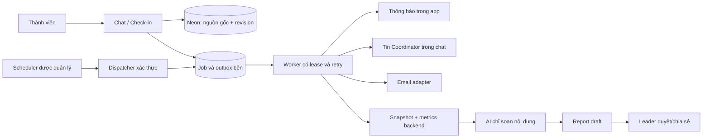

# TV2 — Kế hoạch chat nhóm, Coordinator nhắc việc, check-in hằng ngày và báo cáo tự động

Ngày lập: 07/11/2026. Cập nhật triển khai: **backend V2, migrations, worker, email và report engine đã được xây dựng/kiểm thử cục bộ; automation thật chưa bật**. Frontend đang được triển khai ở phiên riêng theo xác nhận người dùng. Điểm nối: [COORDINATOR_FRONTEND_HANDOFF](COORDINATOR_FRONTEND_HANDOFF.md); kết quả/giới hạn/rollout: [COORDINATOR_OPERATIONS](COORDINATOR_OPERATIONS.md). Checklist nghiệm thu hạ tầng thật bên dưới vẫn cần xác minh, không đồng nghĩa mọi chức năng đã nghiệm thu production.

## 1. Mục tiêu và phạm vi mới

Xây dựng không gian trao đổi công việc của từng dự án, có Coordinator hỗ trợ nhóm theo chu trình:

**Nhắc kế hoạch buổi sáng → trao đổi trong chat → ghi nhận việc đã làm cuối ngày → lưu lịch sử → soạn báo cáo tuần/trước họp → trưởng nhóm kiểm tra và chia sẻ.**

Người dùng đã yêu cầu ba kênh: **thông báo trong ứng dụng, tin nhắn trong chat dự án và email**. Đây là yêu cầu chức năng sản phẩm; phiên lập kế hoạch này không gửi email/tin nhắn, không tạo lịch chạy thật và không gọi AI trên dữ liệu của nhóm.

Yêu cầu mới mở rộng giới hạn MVP cũ vốn chỉ có báo cáo bằng nút và chưa có scheduler. Trong phiên triển khai, cập nhật [AGENTS](../AGENTS.md), [PROJECT_RULES](PROJECT_RULES.md), [CONTRACTS](CONTRACTS.md), [nhiệm vụ TV2](tasks/TV2_TRACKING.md), [nhiệm vụ TV3](tasks/TV3_DELIVERY.md) và các đặc tả UI liên quan để ghi nhận phạm vi automation mới. Không diễn giải rằng hệ thống hiện tại đã có lịch chạy tự động.

Giữ nguyên: quyền theo ProjectMember, human approval cho Plan và nghiệm thu task, task đã công bố không bị bot đổi assignee/deadline/criteria, không suy diễn phần trăm hoặc thời gian lao động từ chat.

### 1.1. Kết quả người dùng cần nhận được

- Thành viên có một nơi trao đổi theo dự án và gắn việc với task cụ thể.
- Hằng ngày nhận lời nhắc đúng lịch; gửi một cập nhật ngắn, không viết nhiều báo cáo trùng nhau.
- Tin nhắn/check-in được lưu bền ngay cả khi AI hoặc email provider lỗi.
- Trưởng nhóm biết ai đã cập nhật, công việc đang ở bước nào, blocker và việc cần hỗ trợ.
- Cuối tuần làm việc có bản tổng hợp đến thời điểm chụp; trước cuộc họp có bản cập nhật đến mốc chuẩn bị họp. Có tùy chọn tổng hợp trọn tuần lịch vào sáng thứ Hai.
- Mỗi số liệu/nhận định mở được nguồn, có thời điểm ghi nhận và mốc chụp dữ liệu.
- Phân biệt được “tự báo xong”, “đã nộp”, “được nghiệm thu”, “chưa có cập nhật”.

### 1.2. Phạm vi chưa làm

Không thêm Slack/Telegram/Discord, Google Calendar/Meet, đọc file/repository/URL bên ngoài, chấm công giám sát, xếp hạng nhân sự, suy đoán chăm/lười, tự giao lại việc hoặc tự nghiệm thu. “Chat” trong tài liệu là chat dự án của TeamFlow AI; “trước họp” dùng lịch cuộc họp được leader nhập trong app, chưa đồng bộ lịch ngoài.

## 2. Hiện trạng và điểm nối

| Thành phần đã có trong code | Tận dụng | Cần bổ sung |
|---|---|---|
| P07, `ProjectChat`, API messages/resolve | UI trao đổi, liên kết task, trạng thái lỗi | Feed có phân trang/cập nhật định kỳ, tin hệ thống, check-in card |
| `TrackingService`, `createTrackingService()` | Quyền task, version, progress, idempotency | Tách nhận tin nhắn khỏi thời gian chờ AI |
| Message và ProgressUpdate | Bằng chứng cập nhật tiến độ | Kết nối với nguồn chat mới và nhật ký ngày |
| Session/membership | Actor và quyền dự án | Job actor có phạm vi rõ, không giả phiên leader |
| AI `coordinator`, `weekly_report` | Provider/validation do TV3 sở hữu | Input check-in/report có cấu trúc, nguồn mới, job nền |
| `readReportSnapshot()`, metrics TV3 | Snapshot nhất quán và logic tính số liệu | Snapshot bất biến đầy đủ, nguồn check-in, bảng theo thành viên |
| P08 và WeeklyReport | Hiển thị report và manual trigger | Draft tự động, publish có người duyệt, báo cáo trước họp |
| Kế hoạch auth | Tài khoản thật/email/verified status | Email nhắc việc chỉ dùng địa chỉ đã xác minh |

Hiện luồng tracking có thể chờ AI trước khi ghi Message; AI lỗi thì giao dịch không lưu tin nhắn. Cách này giữ atomic cho cập nhật tiến độ nhưng không phù hợp làm chat nhóm thông thường. Luồng chat mới phải lưu nguồn trước, phân tích sau, đồng thời giữ contract cũ hoạt động trong thời gian chuyển đổi.

Phần đăng ký/đăng nhập đang có thay đổi trong working tree khi lập tài liệu. Không coi là dependency đã nghiệm thu, không sửa hoặc merge các thay đổi đó trong phiên lập kế hoạch này. Đọc [AUTH_IMPLEMENTATION_PLAN](AUTH_IMPLEMENTATION_PLAN.md) và kiểm lại code trước triển khai.

## 3. Phương án kiến trúc đề xuất

### 3.1. Giữ ứng dụng hiện tại, thêm automation có hàng đợi bền

Giữ Next.js + Drizzle + Neon làm hệ thống chính. Bổ sung scheduler được quản lý bên ngoài request người dùng, hàng đợi job trong PostgreSQL và adapter email. Bản đầu không cần Redis, một backend chat riêng hoặc một agent tự do chạy liên tục.

Tách trách nhiệm:

- **Scheduler:** đánh thức hệ thống, không tự quyết định người nhận/quyền/nội dung.
- **Dispatcher:** tìm lịch đến hạn, tạo occurrence/job chống trùng.
- **Worker:** thực hiện một loại việc đã được lập trình, kiểm lại quyền và eligibility.
- **Backend:** lưu dữ liệu, tính số liệu, quản lý trạng thái/transaction.
- **Coordinator AI:** trích ý chính, hỏi lại khi mơ hồ, soạn bản tổng hợp có nguồn; không có quyền tùy ý gửi ra ngoài hoặc sửa DB.

### 3.2. Lựa chọn hạ tầng lịch chạy

Thiết kế adapter scheduler để không phụ thuộc nhà cung cấp. Mục tiêu bản đầu: một nhịp dispatcher/worker khoảng mỗi phút, tìm `nextRunAt <= now`, xử lý theo batch có giới hạn. Không tạo một cron hạ tầng riêng cho mỗi thành viên/ngày.

Nếu host Vercel, đánh giá gói và tính năng lịch thực tế tại triển khai. Tài liệu hiện phân biệt Cron Jobs cũ và Schedules đang beta; Cron Hobby không đáp ứng lịch nhắc chính xác theo phút, Schedules có jitter riêng. Không mặc định free tier bảo đảm nhắc trước họp đúng phút. Nếu lựa chọn của hosting không đạt mục tiêu, dùng managed scheduler khác gọi endpoint có xác thực hoặc worker luôn chạy trên hạ tầng phù hợp. Chốt một adapter trong task nền tảng, không triển khai ba giải pháp cùng lúc. Nguồn: [Vercel Schedules](https://vercel.com/docs/schedules), [Cron limits](https://vercel.com/docs/schedules/cron-jobs/usage-and-pricing).

Không dùng `setInterval`, `node-cron` khởi động trong Next route, tab trình duyệt, hay một request HTTP mở lâu làm nguồn lịch chính. Tác vụ phải chạy được khi không ai mở app.

### 3.3. Chat cập nhật nhanh với chi phí thấp

- Bản đầu polling incremental 5–10 giây khi tab chat đang hiển thị; ngừng khi hidden/offline, lấy bù theo cursor khi quay lại.
- Chỉ lấy dữ liệu sau cursor, không tải lại toàn bộ context/tasks/history mỗi lần.
- Lấy lịch sử 50 item/trang, tối đa 100; nút tải tin cũ, thứ tự ổn định theo server cursor.
- Nếu người dùng đang đọc tin cũ, hiện “Có tin nhắn mới”, không kéo mất vị trí.
- SSE/WebSocket chỉ bổ sung khi đo được polling không đạt nhu cầu; không phải điều kiện cho check-in/report.
- UI và thông báo gọi chung endpoint incremental cần thiết; tránh mỗi component tự polling riêng gây tăng query.

## 4. Lịch và trải nghiệm đề xuất

Tất cả giờ dưới đây là mặc định có thể chỉnh bởi leader, dùng timezone dự án `Asia/Ho_Chi_Minh`; lưu Instant bằng UTC. Các ngày làm việc mặc định thứ Hai–thứ Sáu; ngoại lệ nghỉ/ngày lễ cấu hình rõ ràng.

| Thời điểm | Mục đích | App | Chat dự án | Email |
|---|---|---|---|---|
| 09:00 ngày làm việc | Nhắc xem task và ghi kế hoạch hôm nay | Một notification/người đủ điều kiện | Một tin chung của Coordinator | Digest cá nhân gộp dự án đủ điều kiện |
| 17:00 ngày làm việc | Hỏi đã làm gì, blocker, kế hoạch tiếp theo | Nhắc người chưa gửi check-in cuối ngày | Một tin chung nếu còn người chưa gửi | Digest cho người chưa gửi |
| Nhắc lại 17:30 | Tùy chọn, mặc định tắt | Tối đa một lần/ngày | Không thêm tin hàng loạt | Tôn trọng preference và quiet hours |
| Thứ Sáu 18:00 | Soạn tuần làm việc từ thứ Hai đến mốc chụp thực tế | Leader nhận thông báo draft | Chưa đăng nội dung draft vào chat | Leader nhận liên kết draft nếu bật email |
| Trước họp 30 phút | Soạn bản chuẩn bị họp | Leader nhận draft | Chỉ hiện sau publish | Leader nhận liên kết nếu bật email |

Lời nhắc chat là một item chung, không tạo 8 tin cho nhóm 8 người. Từng thành viên có nút “Cập nhật hôm nay” mở đúng project/workDate của mình. Sau khi mọi người đã gửi cuối ngày, bỏ occurrence nhắc cuối ngày hoặc tạo trạng thái `skipped`, không gửi tin rỗng.

Nhắc không đồng nghĩa đánh giá đi làm. Người chưa gửi được ghi “Chưa có cập nhật tại mốc ...”, không ghi “Không làm việc” hoặc “Vắng mặt”.

Email không chứa toàn bộ trao đổi/bài nộp/report theo mặc định: tên dự án cần thiết, mục nhắc, deadline cập nhật và link về app. Muốn xem dữ liệu phải đăng nhập và qua membership.

## 5. Danh sách chức năng chi tiết

### CHAT-01 — Chat công việc giữa thành viên

**Owner:** TV2. Mỗi dự án một kênh nhóm trong P07; chưa làm chat riêng/direct message hoặc nhiều phòng tùy ý.

- Thành viên có membership được đọc/gửi; mỗi tin có tác giả, thời điểm server, nội dung và task đính kèm tùy chọn.
- Tối đa 8.000 ký tự/tin và 32 KB body; text/Markdown hiển thị an toàn, không thực thi code hoặc tải URL.
- Nhập `@` chọn member cùng project; `#` chọn task chính thức đã publish. Không resolve nhắc tên mơ hồ thành user ngoài dự án.
- V1 chưa cần thread phức tạp; có thể trích dẫn một tin cùng dự án bằng `replyToId` hợp lệ, không tải thread không giới hạn.
- Gửi tin với client request ID/idempotency key ổn định. Sau khi server lưu thành công, UI đánh dấu “Đã lưu”; không chờ AI và không coi trạng thái optimistic là đã lưu thật.
- Mất mạng giữ draft trong bộ nhớ component, có retry; không ghi secret hay nội dung vào URL. Không tự gửi lại thành nhiều tin khi reconnect.
- Sửa/xóa tin nhắn người dùng để sau bản đầu. Nhật ký sửa check-in có chức năng riêng; không cho xóa âm thầm nguồn đã dùng trong report.

**Nghiệm thu:** hai browser context trao đổi được, reload còn tin, không lộ project khác, retry/concurrent không nhân bản, AI outage không chặn lưu chat.

### CHAT-02 — Nguồn chat bền trước, xử lý Coordinator ở nền

Đề xuất thêm `chat_posts` làm nguồn trao đổi gốc, thay vì ép tin chưa phân tích thành Message có `aiMode=mock` hoặc `resolution=no_change` giả.

1. Request xác thực member, kiểm input/task cùng dự án, lưu ChatPost và enqueue job phân tích trong cùng transaction.
2. Trả HTTP 201 sau DB commit với `analysisStatus=queued`. UI có thể hiện “Đang phân tích cập nhật”; tin vẫn đọc được ngay.
3. Worker chỉ phân tích tin có dấu hiệu cập nhật công việc hoặc do thành viên chọn “Ghi nhận cập nhật”. Chat xã giao không bắt buộc gọi AI.
4. AI lỗi: ChatPost vẫn tồn tại; job retry có giới hạn; UI ghi “Đã lưu tin nhắn, chưa phân tích được”. Không báo đã cập nhật task.
5. Với cập nhật rõ task/ý định/quyền, tạo Message domain/ProgressUpdate theo policy tracking hiện có. Thêm liên kết `chatPostId` nullable unique vào Message để chống phân tích trùng.
6. Mơ hồ: lưu đề xuất/câu hỏi làm rõ gắn nguồn, người gửi chọn đúng task/trạng thái. Không đoán phần trăm/deadline/assignee.
7. “Đã xong” chỉ là lời tự báo; gợi ý nộp bài, không chuyển `done`.
8. Tin hệ thống không chạy lại qua pipeline phân tích chat để tránh vòng lặp bot tự trả lời mình.

Với post gắn task rõ từ lúc gửi, server ghi nhận `taskVersionAtPost`/mốc event liên quan. Trước mutation, worker kiểm task version và không có sự kiện mới hơn khiến nội dung cũ thành stale. Job trễ quá 30 phút chỉ tạo đề xuất cần xác nhận, không tự áp một câu báo blocker cũ lên trạng thái mới. Hai post cùng task được xử lý theo thứ tự hợp lệ hoặc từ chối stale, không lấy thứ tự worker hoàn thành làm thứ tự nghiệp vụ. Khi resolve, tác giả xác nhận `expectedTaskVersion` hiện tại.

Feed mới là discriminated union của ChatPost, CoordinatorEvent và Message legacy chưa có `chatPostId`; Message sinh từ ChatPost không hiển thị thành hai tin giống nhau. API/Message cũ giữ contract cho caller chưa chuyển. Không fake một User/ProjectMember tên Bot để lách FK.

### CHAT-03 — Tin nhắn của Coordinator và thông báo trong app

- Tin Coordinator hiển thị nhãn “Hệ thống”; nhãn AI chỉ dùng cho phần thật sự do AI tạo.
- Reminder dùng template cố định, không gọi LLM chỉ để viết “Bạn hãy cập nhật hôm nay”.
- Một event có thể sinh nhiều notification cá nhân nhưng chỉ một item trong chat dự án.
- Inbox mỗi user có unread/read, số lượng chưa đọc, lọc theo dự án, link đến check-in/task/report; mark-read chỉ được thao tác notification của chính mình.
- `readAt` không đồng nghĩa đã làm việc hoặc đã gửi check-in. Không dùng trạng thái đọc làm số liệu năng suất.
- Các event đầu tiên: `morning_prompt`, `daily_checkin_prompt`, `mention`, `report_draft_ready`, `report_published`, `automation_attention`.
- Report draft chỉ hiện cho leader. Event/notification/email không chứa nội dung draft cho member chưa có quyền.
- Mention notifications có chống trùng; tin gắn nhiều người không gửi email riêng từng mention liên tục trong bản đầu.

### CHAT-04 — Nhắc việc theo ngày, thành viên và ba kênh

**Leader:** bật automation, chọn ngày/giờ/timezone, người tham gia check-in và hiệu lực lịch. Mặc định tắt cho đến khi cấu hình hợp lệ; có preview lịch trước khi bật và có nút tạm dừng.

**Thành viên:** chọn nhận email, timezone/khung giờ digest và quiet hours ở cấp tài khoản; chọn tham gia/tạm nghỉ theo từng dự án. Tạm nghỉ chỉ ảnh hưởng lời nhắc/check-in được kỳ vọng, không tự sửa task/deadline.

Quy tắc chọn người nhận:

1. Project còn bật automation và occurrence thuộc phiên bản lịch có hiệu lực.
2. Member thuộc danh sách tham gia ở ngày đó; vẫn có membership khi worker chuẩn bị gửi.
3. Không thuộc ngày nghỉ/tạm dừng của chính người đó hoặc dự án.
4. Nhắc cuối ngày chỉ cho người chưa có check-in `submitted` của workDate tương ứng.
5. Email chỉ gửi nếu người dùng bật kênh, email đã verified và không bị suppression do bounce/complaint.
6. Nếu email chưa cấu hình hoặc chưa verified, app/chat vẫn chạy; không ghi “email đã gửi”.

Quiet hours cá nhân dịch chuyển email/thông báo cá nhân trong cửa sổ occurrence; không dời tin chung của toàn dự án theo từng người. Thành viên thuộc nhiều dự án nhận tối đa một email digest buổi sáng và một email cuối ngày theo user + local date + slot ở timezone cá nhân; mỗi mục vẫn có project/check-in riêng. Các project có giờ nhắc khác nhau vẫn gửi app/chat theo lịch project, còn email theo khung cá nhân và gom những yêu cầu có hiệu lực đến mốc đó. Project bật sau mốc digest không tạo thêm email cùng slot; app/chat vẫn hoạt động, email xét ở slot tiếp theo còn phù hợp. Không gộp dữ liệu của người khác vào digest.

### CHAT-05 — Kế hoạch đầu ngày và check-in cuối ngày

Một check-in logic cho `(projectId, memberId, workDate)`, được bổ sung theo ngày, không tạo hai bản tính trùng vì có hai lời nhắc.

**Đầu ngày:** nhập/chọn việc dự kiến làm và blocker đã biết. Đây là kế hoạch, không tính là thành tích đã thực hiện.

**Cuối ngày:** biểu mẫu ngắn trong chat có các trường:

| Trường | Bắt buộc? | Ý nghĩa |
|---|---|---|
| `workDate` | Có, mặc định hôm nay theo project timezone | Ngày thực hiện, khác ngày gửi |
| `completedWork` | Có, hoặc chọn “Hôm nay chưa có cập nhật công việc” | Đã làm gì, kết quả cụ thể; không ép phải khai một thành tích |
| `taskId` ở từng work item | Không | Task cùng dự án nếu xác định được; việc hỗ trợ ngoài task giữ `taskId=null` |
| `blockers` | Không | Trở ngại và hỗ trợ cần thiết |
| `nextActions` | Không | Bước tiếp theo/dự kiến ngày mai |
| `durationMinutes` ở từng work item | Không | Thời gian thành viên tự khai; không phải giờ đo tự động |
| `sourcePostIds` | Không | Tin nhắn của chính tác giả/các nguồn đúng project đã chọn |

- Gợi ý từ task, progress/submission đã lưu và chat trong ngày của người gửi; không tự nhận phần việc người khác là của mình.
- Form autosave draft có `expectedVersion`; CTA “Gửi cập nhật” tạo revision submitted. Dữ liệu gốc/draft được lưu tự động, còn chỉ bản submitted được tính vào rollup check-in chính thức.
- Có thể gửi từ card trên app, chat hoặc email link; email link chỉ mở app, không cho người giữ link ghi dữ liệu nếu chưa xác thực.
- Người gửi có thể bổ sung ngày đã qua trong 7 ngày gần nhất; ngày tương lai bị chặn. Ghi `workDate`, `submittedAt`, `revisedAt` riêng; không backdate thời điểm server.
- Không bắt buộc có task được giao mới được check-in; việc phối hợp/hỗ trợ vẫn có giá trị và có nguồn tự khai.
- Leader xem được check-in trong dự án nhưng không âm thầm sửa dưới danh tính member. Muốn bổ sung nhận xét thì ghi event riêng có actor thật.

**Nghiệm thu:** gửi từ các kênh vẫn cập nhật cùng một check-in; autosave/reload giữ dữ liệu; gửi cuối ngày không làm task tự `done`; sửa có version conflict rõ ràng.

### CHAT-06 — Lưu revision, trích nội dung và tránh tính trùng

- ChatPost là nguồn gốc; DailyCheckinRevision là bản thành viên đã gửi/chỉnh sửa, append-only.
- DailyCheckin giữ con trỏ bản draft/current/latestSubmitted; mỗi lần sửa submitted sinh revision mới, giữ bản trước.
- Khi tính báo cáo, lấy đúng một revision submitted mới nhất được thấy tại `asOf` cho mỗi check-in; không cộng tất cả revision.
- Work item có ID ổn định trong check-in. AI đề xuất lại từ cùng tin nhắn không tạo thêm work item trùng tự động.
- Tóm tắt AI có `aiMode`, source refs, trạng thái validation và model/prompt version trong metadata server. Không thay nội dung raw bằng bản AI viết lại.
- Task chưa xác định được thì lưu note có nguồn, không tự tạo task mới. Người dùng có thể gắn lại đúng task trong revision tiếp theo.
- Số phút chỉ nhận số người dùng nhập rõ hoặc xác nhận từ trích xuất. Câu “làm cả buổi”, “mất khá lâu” để thời gian chưa xác định; không tự đổi thành 4 giờ.
- Tổng thời gian trong một ngày/project không vượt 1.440 phút; tổng nhiều project vượt ngưỡng hợp lý thì cảnh báo, không tự chỉnh số hoặc suy giờ làm thực tế. Không cộng thời gian cùng một work item lặp qua các revision.

### CHAT-07 — Nhắc thiếu cập nhật và hiển thị blocker

- Leader có bảng trong P07: member, kế hoạch hôm nay, trạng thái check-in, lần cập nhật gần nhất, blocker và task liên quan.
- Trạng thái gồm `not_requested`, `awaiting`, `draft`, `submitted`, `paused`, `skipped`; không gộp mọi trạng thái thành “chưa làm”.
- Mẫu số người cần check-in lấy từ DailyCheckinRequest snapshot ngày đó, không lấy roster hiện tại áp ngược cả tuần.
- Nhắc lại tối đa một lần khi được bật, chỉ nhắc người còn awaiting/draft; gửi xong phải kiểm lại nếu check-in vừa submit trước lúc phát email.
- Blocker có thể được đánh dấu đã xử lý bằng cập nhật có nguồn; không để một câu blocker cũ bị lặp mãi sau khi task hoặc check-in mới đã giải thích hết vướng mắc.
- Không ping @everyone mỗi khi có một người chưa gửi. Không tự gửi cảnh cáo hoặc đánh giá hiệu suất.

### CHAT-08 — Báo cáo tuần tự động

**Owner:** TV2 schedule/job/nguồn; TV3 core report/AI/P08. Report vẫn là năng lực sản phẩm của Coordinator, không chuyển toàn bộ module delivery về TV2.

1. Default chạy thứ Sáu 18:00, tổng hợp tuần làm việc: `[thứ Hai 00:00, asOf thực tế)` theo project timezone. Nhãn ghi rõ “Tuần làm việc đến thời điểm chụp”, không nói đã bao gồm cuối tuần chưa diễn ra. Nếu cần đủ tuần lịch, leader chọn thứ Hai 08:30 với kỳ `[thứ Hai tuần trước 00:00, thứ Hai tuần này 00:00)`.
2. Worker lập report request có dedupe key ổn định từ project + loại báo cáo tuần tự động + weekStart + chế độ kỳ/slot tuần. PeriodEnd động của tuần làm việc chỉ được chốt một lần khi tạo snapshot, không đưa timestamp retry vào khóa để sinh thêm report. Schedule revision nằm trong payload để kiểm lịch còn hiệu lực, không làm cùng occurrence đổi danh tính. Manual refresh tạo request ID/revision mới có chủ đích.
3. Đọc nguồn trong transaction repeatable-read, lấy DB timestamp làm `asOf`, lưu snapshot bất biến trước khi gọi AI.
4. Backend tính số liệu từ snapshot. AI chỉ viết nhận định có tham chiếu, không tự tính lại metric hoặc sửa task.
5. Thành công lưu draft cho leader; notification/email báo “Bản nháp sẵn sàng”. Không tự gửi đầy đủ nội dung draft cho cả nhóm.
6. Leader có thể sửa phần diễn giải qua revision có audit; metrics/sources không sửa bằng text. Muốn đổi dữ liệu/kỳ thì tạo bản report mới.
7. Leader bấm “Chia sẻ với nhóm”: công bố đúng revision, tạo một event chat + app notification và email tóm tắt nếu thành viên bật nhận báo cáo.
8. Giữ nút tạo báo cáo thủ công; manual và scheduled dùng chung engine snapshot/metrics. Không để hai bộ thuật toán khác nhau tính cùng một chỉ số.

Leader có thể đổi lịch cuối tuần hoặc dùng tùy chọn trọn tuần lịch sáng thứ Hai. Mọi kỳ chưa kết thúc đều được chặn hoặc chuyển thành “Báo cáo đến hiện tại” có nhãn rõ; không đặt periodEnd vào tương lai. Check-in bổ sung sau mốc chụp không tự sửa bản đã soạn.

### CHAT-09 — Báo cáo trước cuộc họp

- Leader nhập tên cuộc họp, thời gian bắt đầu có timezone và thời gian chuẩn bị, mặc định 30 phút.
- UI nằm trong panel lịch/report hiện có P08/P07, không cần sản phẩm lịch ngoài hoặc trang quản trị lịch phức tạp.
- Default period là tuần hiện tại đến mốc snapshot khi chuẩn bị; leader có thể chọn since-last-meeting hoặc custom, mọi trường hợp phải hiện rõ `[start,end)`.
- Đổi giờ họp tăng meeting revision, hủy job cũ; worker recheck revision/canceled trước khi tạo draft.
- Tạo họp quá sát: cung cấp “Soạn ngay”, không hứa gửi trước 30 phút khi mốc đó đã qua.
- Họp bị hủy: không tạo report/nhắc mới. Job thức dậy sau giờ bắt đầu cuộc họp được đánh dấu expired, không spam bản “chuẩn bị” sau họp.
- Báo cáo tuần và trước họp là hai mục đích có ID riêng; chỉ tái dùng phần tính toán/cache khi snapshot hash thực sự giống nhau, không gộp nhầm bản chụp khác thời điểm.
- Draft trước họp vẫn chỉ leader xem cho đến khi share. Khi cần thay số liệu mới hơn, tạo revision/snapshot mới và giữ bản cũ.

### CHAT-10 — Nội dung và số liệu báo cáo

Báo cáo gồm: kỳ báo cáo/timezone, `asOf`, nguồn dữ liệu, tổng quan dự án, bảng từng thành viên, việc đã nghiệm thu, việc đã nộp/chờ review, blocker, việc tiếp theo và phần dữ liệu còn thiếu.

| Chỉ số/thông tin | Cách xác định | Giới hạn phải nói rõ |
|---|---|---|
| Việc đã làm trong kỳ | Work item check-in submitted, lọc theo workDate và revision tại asOf | Nội dung tự khai, không tự coi là nghiệm thu |
| Trạng thái task | Task chính thức trong snapshot tại asOf | Không phải trạng thái tự đoán từ câu chat |
| Task được nghiệm thu trong kỳ | Acceptance event có `acceptedAt` trong kỳ | Khác tổng task hiện đang done |
| Task đã nộp trong kỳ | Submission có `submittedAt` trong kỳ, đếm task distinct và lượt nộp riêng | Không cộng revision thành nhiều task hoàn thành |
| Đúng hạn | `submittedAt` và `acceptedAt` so với deadline, hai chỉ số riêng | Nộp đúng hạn vẫn có thể nghiệm thu trễ |
| Mức hoàn thành dự án | Mặc định hiển thị `done / tổng task chính thức tại asOf` và bảng status | Đây là số lượng task, không phải công sức hoặc chất lượng |
| Tỷ lệ theo số task, nếu cần | `doneCount / totalPublishedTaskCount * 100`; N/A khi mẫu số 0 | Nhãn rõ “Theo số task”; không suy task lớn nhỏ ngang nhau về effort |
| Tiêu chí review | Kết quả criterion của đúng bài nộp/review liên quan | Không chuyển tỷ lệ criterion met thành % tiến độ toàn dự án |
| Thời gian đã khai | Tổng `durationMinutes` từ work item submitted, lấy một revision hợp lệ/check-in | Tự khai, không phải chấm công; thiếu số phút là unknown, không mặc định 0 |
| Thời gian xử lý task | Event bắt đầu hợp lệ → acceptance, nếu đủ lịch sử | Thời gian lịch trôi qua, khác giờ làm thực tế |
| Bao phủ check-in | Submitted requests / eligible requests snapshot trong kỳ | Chỉ đo việc cập nhật, không xếp hạng năng suất |
| Không cập nhật | Không có submitted check-in hoặc nguồn trong kỳ | Không kết luận người đó không làm việc |

Bảng thành viên gồm tên/membership, việc tự báo, task chính thức liên quan, đã nộp/đã nghiệm thu, blocker, phút tự khai hoặc “Chưa ghi nhận”, lần cập nhật cuối và link nguồn. Không đặt tên/thành tích cứng từ fixture, không tạo bảng xếp hạng.

AI chưa đủ bằng chứng phải nêu “Chưa có dữ liệu để kết luận”. Mỗi đoạn summary phải dẫn nguồn hợp lệ hoặc metric key backend; validation loại source khác project, quote không tồn tại và giá trị số trái metrics. Job summary lỗi vẫn giữ snapshot/số liệu đã tính, hiện “Chưa tạo được diễn giải AI”; không thay bằng mock trong production một cách âm thầm.

### CHAT-11 — Sổ sự kiện task và snapshot bất biến

- Bổ sung `task_activity_events` append-only cùng transaction khi publish, progress, submit, review đổi trạng thái và acceptance. Có task version, actor/service actor, event type, before/after, occurredAt, nguồn liên quan.
- Không suy lịch sử nhiều lần chuyển trạng thái chỉ từ cột `Task.status` hiện tại hoặc một field `acceptedAt`.
- Migration cũ chỉ tạo baseline “trạng thái được biết tại ngày đưa tính năng vào chạy”; không dựng các sự kiện quá khứ chưa có bằng chứng. Báo cáo kỳ vượt thời điểm bắt đầu ghi event phải nêu coverage thiếu.
- Snapshot report lưu cả dữ liệu/phiên bản cần thiết, không chỉ danh sách ID trỏ tới Task/check-in có thể đổi sau đó. P08 mở “Nguồn tại mốc chụp”; link “Bản ghi hiện tại” là chức năng riêng có nhãn.
- Worker chậm không được giả `asOf` bằng giờ dự kiến. Period tuần vẫn giữ kỳ cũ; metadata ghi scheduledFor, startedAt, completedAt và asOf thực tế. Số trạng thái được gọi là tại asOf thực tế, không nói là lịch sử tại periodEnd nếu chưa có tái dựng event đầy đủ.
- Bổ sung check-in muộn hoặc sửa dữ liệu sau snapshot không làm report cũ đổi; có badge “Có cập nhật mới sau mốc chụp”, leader tạo bản cập nhật nếu cần.

### CHAT-12 — Lịch, job, retry và vận hành

- Mỗi occurrence có dedupe key bền; unique constraint là hàng rào cuối cùng khi hai dispatcher cùng chạy.
- Dispatcher dùng cursor/`nextRunAt`, không chỉ so “bây giờ có đúng phút hẹn không”; có catch-up khi scheduler bỏ một nhịp.
- Claim job bằng transaction ngắn và row lock/lease, sau đó commit trước khi gọi AI/mail. PostgreSQL hỗ trợ `SKIP LOCKED` cho nhiều consumer kiểu queue; không dùng nó để đọc snapshot báo cáo. Tham chiếu [PostgreSQL SELECT](https://www.postgresql.org/docs/current/sql-select.html).
- Job có lease owner, lockedUntil và fencing/claim token; worker cũ quá lease không được ghi đè kết quả worker mới. Hạn lease lớn hơn timeout tác vụ, renew có giới hạn nếu cần.
- Retry lỗi tạm thời theo backoff có jitter, đề xuất 1/5/15 phút, tối đa 5 attempts; auth/config/validation sai đưa attention thay vì retry vô hạn. Respect Retry-After của provider.
- V1 giới hạn 2 job AI chạy đồng thời, mỗi tick claim batch nhỏ và có time budget; cấu hình theo thời gian function thực tế. Không giữ HTTP request chờ toàn bộ project xong.
- Job in-app/chat chỉ ghi DB có thể atomic cùng unique event. Email là side effect ngoài DB: dùng outbox và idempotency provider, không tuyên bố bảo đảm exactly-once qua mọi failure.
- Email timeout sau khi provider có thể đã nhận phải được coi là delivery uncertain; retry cùng provider key trong cửa sổ được hỗ trợ. Quá cửa sổ thì chuyển kiểm tra/attention, không tự tạo key mới gửi lại.
- Nếu chọn Resend, idempotency key hiện có cửa sổ 24 giờ; dedupe DB của ứng dụng phải giữ lâu hơn và theo dõi provider ID. Tham chiếu [Resend Idempotency](https://resend.com/docs/dashboard/emails/idempotency-keys).
- Email `accepted` không đồng nghĩa delivered/read. Webhook đã kiểm chữ ký cập nhật delivered/bounced/complained bằng event ID chống trùng; không dùng email open để suy làm việc.
- Reminder trễ quá 60 phút hoặc đã qua workDate/quiet window thì skipped/expired, không gửi bù cả loạt ngày cũ. Weekly draft có thể catch-up trong 24 giờ; quá hạn hiện leader attention + nút soạn lại. Meeting draft chỉ catch-up trước giờ họp.
- Leader thấy lịch chạy gần nhất/kế tiếp, số job lỗi và nút retry có kiểm quyền. Không cần dựng hệ quản trị job toàn hệ thống trong MVP mở rộng.

## 6. Thiết kế dữ liệu đề xuất

TV2 là người duy nhất điều phối schema/migrations. Tên bảng/field là đề xuất cho phiên triển khai, chưa phải code đã có.

| Bảng | Dữ liệu chính | Constraint/điểm quan trọng |
|---|---|---|
| `chat_posts` | projectId, authorMemberId, content, taskId?, taskVersionAtPost?, replyToId?, createdAt, clientRequestId, analysisStatus | Scope theo project; unique actor + clientRequestId; nguồn gốc tồn tại độc lập AI |
| `coordinator_events` | projectId, eventType, occurrenceKey, text/template, source refs, createdAt | Unique occurrenceKey + eventType; bot sender riêng, không giả User |
| `project_coordinator_settings` | timezone, workdays, morning/eod/weekly schedule, channel defaults, enabled, version, enabledByMemberId | Leader cấu hình, version lịch, nextRunAt có index |
| `user_notification_preferences` | userId, timezone, emailEnabled, morning/eod digest time, quiet hours | Một preference/user để gộp email đa project; chủ tài khoản tự sửa |
| `member_checkin_preferences` | projectId, memberId, participation, paused dates | Unique project + member; member chỉ sửa preference của mình |
| `daily_checkin_requests` | projectId, memberId, workDate, expected slots, requestedAt, eligibility snapshot, status | Unique project + member + workDate; giữ mẫu số lịch sử |
| `daily_checkins` | projectId, memberId, workDate, version, draft payload, latestSubmittedRevisionId | Unique project + member + workDate; optimistic version |
| `daily_checkin_revisions` | checkinId, revision, plannedWork, completed items có ID/task/minutes, blockers, nextActions, sources, submittedAt | Append-only; unique checkinId + revision |
| `notifications` | recipientUserId, projectId, event/dedupe key, type, target, createdAt, readAt | Chỉ người nhận đọc/đánh dấu; unique recipient + event key |
| `automation_jobs` | type, projectId?, runAt, priority, payload ref, dedupeKey, attempts, status, lease, lastErrorCode | Queue và outbox delivery dùng chung primitive; index queued/runAt và lease expiry |
| `project_meetings` | projectId, title, startsAt, timezone, leadMinutes, period policy, version, canceledAt | Đổi lịch tăng version; job tham chiếu meeting version |
| `task_activity_events` | projectId, taskId, taskVersion, kind, actor, before/after, source refs, occurredAt | Append-only; unique task + version + event kind phù hợp |
| `coordinator_report_runs` | projectId, trigger type, period, asOf, schedule/meeting version, status, snapshot JSONB, metrics JSONB, summary revisions, publishedAt/by | Dedupe report request; frozen snapshot; draft/published có quyền riêng |

Quan hệ bổ sung: `messages.chatPostId` nullable unique FK; dữ liệu legacy giữ nguyên. Source refs V2 có thể gồm ChatPost, CheckinRevision, TaskActivityEvent ngoài entity V1; phải tạo schema V2 thay vì làm caller cũ hiểu sai enum.

Để giữ quy mô triển khai vừa phải:

- Work items/minutes được lưu trong JSONB của revision, chưa cần một hệ time tracking hay bảng task subprogress riêng.
- Queue/outbox dùng cùng engine `automation_jobs`; job payload chứa ID/reference, không sao chép toàn bộ chat/secret vào log.
- `coordinator_report_runs` gom request, snapshot và artifact V2 ở bản đầu; chưa tách nhiều bảng report metadata không cần thiết.
- Không cố nhét tin hệ thống vào Message có FK tác giả là member, không mạo danh người dùng để tiết kiệm một bảng.

Migration phải additive, có backfill baseline cần thiết, không đánh số migration trước khi đối chiếu journal vì auth đang có migration mới. Không sửa SQL đã áp, không reset User/Project/Task/Message/Submission/Report cũ.

## 7. API đề xuất và tương thích

Mọi API người dùng kiểm session, membership, strict body, giới hạn input và origin ở mutation. Idempotency có scope user/operation/input; kiểm quyền hiện tại trước replay.

| API mới/điều chỉnh | Quyền | Mục đích |
|---|---|---|
| `GET /api/projects/:id/chat-feed?after=&before=&limit=` | Member | Feed V2 phân trang; schema union rõ từng loại |
| `POST /api/projects/:id/chat-posts` | Member | Lưu raw chat + job atomic, trả 201 sau lưu |
| `POST /api/chat-posts/:id/resolve` | Tác giả, đúng quyền task | Xác nhận task/ý định từ đề xuất mơ hồ |
| `GET /api/projects/:id/checkins?workDate=` | Member | Xem check-in theo ngày trong dự án |
| `PUT /api/projects/:id/checkins/me/:workDate/draft` | Chính member | Autosave draft + expectedVersion |
| `POST /api/projects/:id/checkins/me/:workDate/submit` | Chính member | Tạo revision submitted, chống retry trùng |
| `GET/PATCH /api/projects/:id/coordinator-settings` | Member đọc; leader sửa | Lịch, đối tượng, kênh, bật/tắt; không trả secret |
| `PATCH /api/projects/:id/checkin-preferences/me` | Chính member | Quiet hours, kênh cá nhân, tạm nghỉ |
| `GET /api/notifications?cursor=` | Chính user | Inbox incremental |
| `POST /api/notifications/:id/read` | Chủ notification | Mark-read idempotent |
| `POST/PATCH /api/projects/:id/meetings[/:meetingId]` | Leader | Tạo/đổi/hủy lịch chuẩn bị họp |
| `GET/POST /api/projects/:id/coordinator-reports` | Leader xem draft/tạo; member chỉ published | List/request report V2, trả 202 khi queued |
| `GET /api/coordinator-reports/:id` | Leader hoặc member khi published | Đọc report, metrics, nguồn tại snapshot |
| `POST /api/coordinator-reports/:id/publish` | Leader | Publish đúng expectedVersion, sinh event/outbox |
| `POST /api/coordinator-reports/:id/retry` | Leader | Retry generation lỗi, giữ snapshot hoặc tạo bản mới có nhãn rõ |
| `/api/internal/coordinator/tick` | Service credential | Dispatcher/worker; HTTP method tùy adapter scheduler, không mở cho browser |
| `POST /api/webhooks/email` | Provider signature | Delivery status/bounce, dedupe webhook |

API legacy messages/resolve/reports không bị âm thầm đổi array thành envelope mới. P07/P08 chuyển dùng V2 có adapter và regression tests. Engine report/metrics được TV3 refactor để cả wrapper V1 thủ công và V2 automation dùng cùng logic, không gọi wrapper V1 để tái query một snapshot khác.

## 8. Worker actor, quyền và bảo vệ dữ liệu

- Job không dùng cookie leader, không tạo Session giả để gọi service, không lấy role/userId do AI gửi về.
- Thêm `AutomationExecutionContext` nội bộ gồm job ID, project ID, scope, schedule/meeting version và principal hệ thống. Không expose type này thành JSON input cho browser.
- Worker thực thi đúng allowlist: tạo reminder, phân tích post của tác giả thật, lưu check-in proposal, tạo report draft, gửi notification/email đã định tuyến. Không có tool “chạy SQL bất kỳ”.
- Job phân tích chat đọc author từ ChatPost đã lưu và kiểm tác giả vẫn có quyền phù hợp; hành động tiến độ dùng actor gốc có audit, không được nâng quyền thành leader chỉ vì chạy nền.
- Scheduled report kiểm policy automation đang bật và người cấu hình còn quyền leader; không mượn membership cũ đã bị thay đổi. Policy sai thì pause/attention.
- Mỗi job kiểm project/recipient/member ngay trước side effect. Không thể thu hồi email đã gửi, vì vậy email mặc định chứa nội dung tối thiểu và link bảo vệ.
- Endpoint nội bộ dùng secret chữ ký/bearer hoặc private function theo adapter; rate limit/time budget và deny nếu thiếu secret. Không chạy được bằng một GET công khai từ URL đoán được.
- Email chỉ dùng User.email verified do server đọc; không nhận `to` tùy ý từ prompt/chat. Webhook kiểm chữ ký và timestamp hợp lệ.
- Nội dung chat/check-in/bài nộp là dữ liệu không tin cậy, không phải chỉ dẫn agent. Validation loại yêu cầu đọc project khác, gửi nội dung ra email lạ hoặc tự đổi quyền/task.
- Mọi thành viên đọc được chat/check-in dự án; report draft chỉ leader; published report cho member. Thời gian tự khai được báo trước là dữ liệu chia sẻ trong dự án, không thu thập theo dõi bí mật.
- Không log nội dung nhạy cảm, email raw, cookie, token hoặc connection string. Audit tối thiểu lưu actor, operation, entity, timestamp, outcome.

## 9. Timezone, lịch và các trường hợp khó

| Tình huống | Quy tắc |
|---|---|
| Thành viên làm việc qua nửa đêm | Chọn đúng workDate trong cửa sổ cho phép; giữ submittedAt thực tế |
| Project đổi timezone/giờ nhắc | Tăng schedule version; áp cho occurrence tương lai; không đổi ngày/nguồn report cũ |
| DST với timezone khác Việt Nam | Dùng thư viện timezone phù hợp; policy giờ không tồn tại chuyển đến phút hợp lệ tiếp theo, giờ lặp chỉ một occurrence/local date + slot |
| Scheduler chạy hai lần hoặc bỏ một nhịp | Unique occurrence + catch-up, không mất hoặc nhân bản reminder |
| Worker chết sau claim | Lease hết hạn cho reclaim; fencing chặn ghi kết quả cũ |
| Worker chết sau email provider nhận | Delivery uncertain + provider idempotency; không hứa exactly-once |
| Member gửi check-in đúng lúc job chuẩn bị nhắc | Recheck trạng thái trước phát; có thể còn tin chung đã gửi nhưng không tạo reminder cá nhân mới |
| Member tạm nghỉ/không có task | Paused loại khỏi yêu cầu; người không có task vẫn có thể ghi việc hỗ trợ |
| Nhóm thêm member giữa tuần | Chỉ kỳ vọng từ thời điểm đủ điều kiện; không đếm thiếu cả tuần trước đó |
| Lịch auth/invitation chưa xong | Dev fixture đúng contract; chưa bật email production hoặc tự gán danh tính |
| AI timeout/trả nguồn bịa | Giữ raw/snapshot, đánh dấu lỗi, retry có giới hạn; không ghi Task sai hoặc summary bịa |
| Email provider/domain lỗi | App/chat tiếp tục; email thất bại/attention, không báo delivered |
| Sửa check-in sau report | Report cũ bất biến; report mới có revision/source mới |
| Lịch nhắc vừa bật sau 09:00 | Bắt đầu occurrence tương lai, không gửi bù sáng trừ leader chọn nhắc ngay có nhãn |

## 10. Tối ưu chi phí, tốc độ và chất lượng

1. Reminder, định tuyến và số liệu dùng code/template; không gọi AI theo cron cho từng người nếu không cần nội dung mới.
2. Chat dùng incremental polling và pagination; một lần nạp context khi vào project, không fetch mọi Task/Member mỗi tick.
3. Form check-in cấu trúc là nguồn chính; AI hỗ trợ viết gọn/trích từ nguồn đã chọn, không phân tích lại toàn bộ chat lịch sử mỗi lần mở.
4. AI chỉ nhận nguồn của đúng project và kỳ cần thiết. Lịch sử dài chia batch theo ngày/member, lưu tóm tắt trung gian có refs và invalidation theo revision; không cắt im lặng nguồn quan trọng khi chạm token limit.
5. Report cache theo `snapshotHash + model/promptVersion`; chỉ reuse khi cùng snapshot, không reuse vì cùng tên tuần.
6. Daily recap AI là tùy chọn sau lõi; ưu tiên một report AI/project/kỳ và một report trước họp, không 8 agent riêng cho 8 member.
7. SQL dùng index project/date/member, jobs status/runAt, feed cursor và unique dedupe. Snapshot chỉ lấy dữ liệu cần cho kỳ/metrics, không gửi nguyên DB cho AI.
8. Giới hạn song song và có quota cấu hình theo project; leader thấy job delayed/budget-limited, không giả hoàn tất.
9. Theo dõi p95 lưu chat, độ trễ reminder, job age, AI validation fail, tỷ lệ email accepted/bounced và chi phí/report. Không dùng telemetry này để xếp hạng thành viên.

Mục tiêu nghiệm thu đề xuất, phải đo trên deployment thật: lưu chat p95 dưới 1,5 giây với tải nhóm 3–8 người; nhận tin mới trong 10 giây khi tab mở; reminder đến app/chat trong 5 phút so với lịch khi hệ thống/provider khỏe; report draft trong 5 phút sau trigger với quy mô đã benchmark. Email chỉ có thể cam kết gửi sang provider trong cửa sổ mục tiêu, không bảo đảm thời điểm thư xuất hiện trong hộp thư. Nếu hạ tầng lịch có jitter lớn hơn thì không tuyên bố đạt mục tiêu này.

## 11. Phân công và bản đồ file

| Module | Owner | Công việc |
|---|---|---|
| `src/features/tracking/components/` | TV2 | Feed, check-in card, status người cập nhật, inbox theo project |
| `src/features/tracking/server/` | TV2 | ChatPost/check-in services, policy, legacy adapters |
| `src/server/automation/` mới | TV2 | Scheduler adapter, dispatcher, worker, lease/retry, service actor |
| `src/server/notifications/` mới | TV2 | Inbox/outbox/email adapter và webhook |
| `src/server/db/`, `drizzle/`, `src/contracts/` | TV2 | Schema bổ sung, migrations, V2 DTO/source refs, snapshot readers |
| `src/server/ai/` | TV3 | Check-in extraction/report V2, schema output, guardrails và mode real/mock |
| `src/features/delivery/` và P08 | TV3 | Report engine dùng chung, frozen sources, draft/publish, trước họp |
| Layout/UI primitives/entry chung | TV1 | Điểm gắn notification badge, panel lịch, navigation và accessibility |
| Planning publish event hook | TV1, theo contracts TV2 | Ghi TaskActivityEvent cùng transaction publish |
| Auth/email verified | TV2 phối hợp phiên auth | Identity thật, địa chỉ gửi, verified gate và recipient checks |

Đây là phân công sản phẩm và owner code, không phải yêu cầu chạy sub-agent lập trình trong phiên hiện tại. Với báo cáo/AI, TV2 bàn giao nguồn/job context; TV3 sửa module của mình. Shared contract thay đổi phải cập nhật cả caller/validator, không tự thêm field/schema gây lỗi giữa nhánh.

## 12. Kế hoạch triển khai theo mốc

### M0 — Chốt nền tảng và contracts

- [ ] Đối chiếu auth thật, email verification, migrations và deployment hiện tại.
- [ ] Chốt scheduler adapter có tần suất/jitter phù hợp và dịch vụ email; không cần mua/cấu hình thật trong phiên viết plan.
- [ ] Chốt ChatPost/feed V2, check-in revision, job actor, ReportArtifactV2 và quyền draft/published.
- [ ] Cập nhật scope tài liệu MVP cho scheduler/email, phối hợp TV1/TV3.

### M1 — Chat nhóm bền và check-in thủ công

- [ ] Chat raw lưu ngay, feed pagination/polling, retry/idempotency, mention nội bộ.
- [ ] Coordinator xử lý nền; lỗi AI không mất tin.
- [ ] Form daily plan/check-in, autosave draft, submit revision, dữ liệu thời gian optional.
- [ ] Bảng cập nhật ngày, privacy/membership và baseline task events.

**Demo mốc:** hai tài khoản thật chat → member gửi check-in → leader đọc → reload còn nguồn; thử AI lỗi vẫn gửi được tin.

### M2 — Nhắc tự động đủ app/chat/email

- [ ] Settings lịch/preference, timezone và eligibility requests.
- [ ] Dispatcher/jobs/outbox/lease/retry/dedupe, cảnh báo lỗi cơ bản.
- [ ] App inbox + một tin Coordinator mỗi slot/project.
- [ ] Email verified recipient, digest đa project, delivery webhook/suppression, quiet hours.

**Demo mốc:** đặt lịch gần trong test, đóng mọi tab app; job vẫn tạo app/chat/email đúng người; một member gửi sớm thì không bị email nhắc cuối ngày.

### M3 — Báo cáo tuần và trước họp

- [ ] Snapshot bất biến + metrics/member rollup + source refs V2.
- [ ] Report AI validation, draft leader-only, publish có audit.
- [ ] Lịch tuần, lịch trước họp, đổi/hủy meeting và retry report.
- [ ] P08 nguồn tại snapshot, so với hiện tại, các thời điểm submitted/accepted/self-reported riêng.

**Demo mốc:** report tuần có số liệu đúng; sửa check-in sau snapshot không đổi report cũ; leader share thì cả nhóm mới đọc được.

### M4 — Kiểm thử độ bền và vận hành

- [ ] Crash/retry/race/DST, email uncertain và scheduler downtime.
- [ ] Regression planning/tracking/delivery/auth, prompt injection và API sai quyền.
- [ ] Đo SLO/chi phí, hướng dẫn pause/retry/recover, rollout trên một project trước.

Không dồn toàn bộ M1–M4 vào timeline MVP 4 giờ cũ. Có thể dùng fixture để TV2/TV3 phát triển khi dependency chưa sẵn nhưng phải ghi rõ, không nghiệm thu production bằng fixture.

### 12.1. Backlog và ước lượng công sức

| ID | Task | Owner chính | Dependency | Ước lượng |
|---|---|---|---|---|
| C01 | Contracts V2, scope, deployment/email/scheduler spike | TV2 + TV3 | Auth handoff | 3–5 giờ |
| C02 | Migration, indexes, job/lease/dedupe primitives | TV2 | C01 | 5–8 giờ |
| C03 | Chat raw/feed/API, polling UI và legacy adapters | TV2 | C02 | 6–9 giờ |
| C04 | Daily forms/revisions/work item dedupe/summary proposals | TV2 + TV3 | C03 | 5–8 giờ |
| C05 | Schedule settings, dispatch, app/chat reminder/inbox | TV2, TV1 shell slot | C02, C04 | 5–8 giờ |
| C06 | Email digest, verified gate, webhook, suppression/retry | TV2 | C05, mail/auth sẵn sàng | 4–7 giờ |
| C07 | Task events, immutable report snapshot, member metrics | TV2 + TV3, TV1 publish hook | C04 | 6–9 giờ |
| C08 | Weekly/meeting report jobs, AI, draft/publish P08 | TV3 + TV2 | C05, C07 | 6–9 giờ |
| C09 | Race/failure/security tests, HTTP/browser và vận hành | Theo module | C03–C08 | 6–10 giờ |

Tổng dự kiến **46–73 giờ công** cho phạm vi trên, chưa tính hoàn thiện auth/email verification hoặc mua/cấu hình hạ tầng ngoài. Đây là ước lượng để chia việc; hiệu chỉnh sau C01 và M1. Bản nhỏ có giá trị đầu tiên là M1, tiếp theo M2; không cắt persistence/quyền/dedupe để thêm một kênh hoặc AI đẹp hơn.

## 13. Ma trận kiểm thử và nghiệm thu

| ID | Tình huống | Kết quả bắt buộc |
|---|---|---|
| V01 | Hai member chat, refresh/reconnect/retry | Có một tin gốc, đúng thứ tự, không mất hoặc nhân bản |
| V02 | AI outage/timeout khi gửi chat | Raw đã lưu; analysis failed/queued rõ ràng; task không bị đổi sai |
| V03 | User ngoài project/giả author/role/task khác project | Bị chặn, không lộ nguồn hoặc nhận notification |
| V04 | Bot event quay vào pipeline chat | Không tạo vòng lặp bot hoặc chi phí AI lặp |
| V05 | Hai worker phân tích cùng post | Tối đa một Message/ProgressUpdate hợp lệ |
| V06 | Check-in draft/submit/retry/sửa đồng thời | Một logical check-in, revision rõ, version conflict đúng |
| V07 | Câu “gần xong/làm cả buổi” | Không tự sinh phần trăm hoặc số giờ |
| V08 | Gửi check-in từ link email | Phải login và đúng tác giả; token link không cấp quyền |
| V09 | Hai dispatcher, mất tick, worker chết | Dedupe, catch-up và reclaim lease đúng; không bỏ job âm thầm |
| V10 | Lease cũ hoàn tất muộn | Fencing chặn ghi đè kết quả mới |
| V11 | Check-in submit sát giờ nhắc | Người đã gửi không bị nhắc cá nhân mới; chat tối đa một item slot |
| V12 | Nhiều project của một user | Email digest gộp đúng user, không gộp dữ liệu người khác |
| V13 | Email unverified/opt-out/bounce | Không gửi email; app/chat vẫn hợp lệ; status không giả delivered |
| V14 | Timeout email sau provider nhận | Dùng lại key đúng cửa sổ; hết cửa sổ vào attention, không resend mù |
| V15 | Quiet hours/nghỉ/ngày lễ/timezone/DST | Eligibility/ngày/occurrence đúng và không gửi trùng |
| V16 | Scheduler trễ qua workDate/cuộc họp | Expired/skipped theo policy; không bắn loạt lời nhắc cũ |
| V17 | Member mới giữa tuần/tạm nghỉ | Mẫu số check-in đúng requests snapshot, không áp roster hiện tại ngược quá khứ |
| V18 | Weekly period và deadline tại ranh giới | Dùng [start,end), timezone đúng; không đếm đôi giữa hai kỳ |
| V19 | Tự báo xong nhưng chưa nộp/nghiệm thu | Report phân biệt claim/submission/acceptance; Task chưa done |
| V20 | Nộp đúng hạn, nghiệm thu trễ | Hai số liệu riêng, không gán nộp trễ |
| V21 | Nhiều revision/submission của một task | Không tính thành nhiều task hoàn thành; giờ chỉ một revision/check-in |
| V22 | Không có phút làm việc/không có check-in | Unknown/chưa cập nhật, không suy 0 giờ/không làm |
| V23 | AI bịa nguồn/quote/numbers/instruction injection | Validation chặn, không publish sai hoặc gửi email ra địa chỉ prompt |
| V24 | Draft report và notifications | Chỉ leader thấy; member chỉ xem sau share |
| V25 | Sửa Task/check-in sau snapshot | Report cũ và nguồn snapshot bất biến; hiện tại có link riêng |
| V26 | Thay/hủy meeting hoặc disable schedule trong khi queued | Job cũ không tạo draft/nhắc không còn hợp lệ |
| V27 | Service credential/webhook giả | Không thực thi job hoặc cập nhật delivery |
| V28 | Trình duyệt đóng hoàn toàn | Scheduler vẫn tạo app/chat và gửi email thực trong môi trường test đủ cấu hình |
| V29 | Baseline dữ liệu legacy thiếu task event | Report nêu thiếu coverage; không dựng lịch sử giả |
| V30 | Quy mô nhóm 3–8, nhiều project thử nghiệm | Đạt mục tiêu độ trễ đã đo, batch/quota không gây timeout dây chuyền |

Kế hoạch chạy: `npm run check`, `npm run build`, tests hiện có (`npm test` hoặc `npm run test:managed`, `npm run test:tracking`, `npm run test:legacy-schema`) và bộ tests mới cho chat/check-in/jobs/report. Dùng fake clock cho lịch/race/quiet hours, PGlite cho constraints; xác minh riêng trên Neon và scheduler/email sandbox thật. Chỉ ghi test pass khi đã thực chạy ở phiên triển khai.

## 14. Cấu hình, rollout và bàn giao

### 14.1. Cấu hình dự kiến

`APP_ORIGIN`, `DATABASE_URL`, `DATABASE_DIRECT_URL`, `COORDINATOR_AUTOMATION_ENABLED`, service scheduler credential, `EMAIL_PROVIDER`, mail API key/from domain, webhook signing secret, concurrency/time-budget/quota. Tên chi tiết chốt C01; không thêm secret `NEXT_PUBLIC_*`. Feature automation mặc định tắt, preview/development không gửi mail thật trừ sandbox allowlist.

Leader thấy rõ trạng thái từng kênh: app hoạt động, chat hoạt động, email chưa cấu hình/chưa verified/đã bật/lỗi. Không gom ba trạng thái thành một nhãn “Đã bật tất cả”.

### 14.2. Rollout

1. Hoàn thiện auth handoff và contracts, áp migration additive trên DB test.
2. Chạy M1 với một project; kiểm raw/revision và quyền trước khi bật job tự động.
3. Dry-run scheduler: ghi intended occurrences/recipients, chưa gửi email thật; so với kỳ vọng ngày/giờ.
4. Bật app/chat cho project thử nghiệm, sau đó email với account verified sandbox/allowlist.
5. Chạy một báo cáo tuần giả lập bằng clock test và một report thật ở kỳ phù hợp, so sánh SQL/backend metrics với nguồn.
6. Chỉ mở thêm project khi retry/dedupe/source snapshot và pause switch đã đạt. Có thể pause automation mà chat/check-in thủ công vẫn hoạt động.

### 14.3. Checklist Definition of Done

- [ ] Chat là kênh trao đổi bền, không phụ thuộc AI thành công để lưu.
- [ ] Có nhắc hằng ngày đủ app/chat/email, đúng người/giờ và không spam trùng.
- [ ] Ghi nhận kế hoạch/việc đã làm/time/blocker có revision và nguồn.
- [ ] Scheduler chạy khi mọi tab đóng; job có retry, lease, dedupe và trạng thái lỗi.
- [ ] Report tuần/trước họp có snapshot, metric, bảng thành viên và nguồn mở được.
- [ ] Draft leader-only, publish explicit; bot không tự đổi quyền/task done.
- [ ] Thời gian tự khai, thời gian lịch và thời điểm nộp/nghiệm thu hiển thị riêng.
- [ ] Không có phần trăm/giờ làm/số liệu thành tích suy đoán hoặc fixture giả.
- [ ] Check/build/tests và end-to-end trên hạ tầng test đã chạy; ghi rõ mock/real và giới hạn.
- [ ] Handoff TV2/TV3, contracts và UI specs cập nhật theo scope mới.

Phần mô tả đề xuất bên trên được giữ làm tiêu chí nghiệm thu. Phiên triển khai đã bổ sung code/schema/migration additive; chưa áp lên database chung và chưa bật gửi thông báo thực tế. Tích hợp frontend và end-to-end thật tiếp tục theo tài liệu bàn giao.
