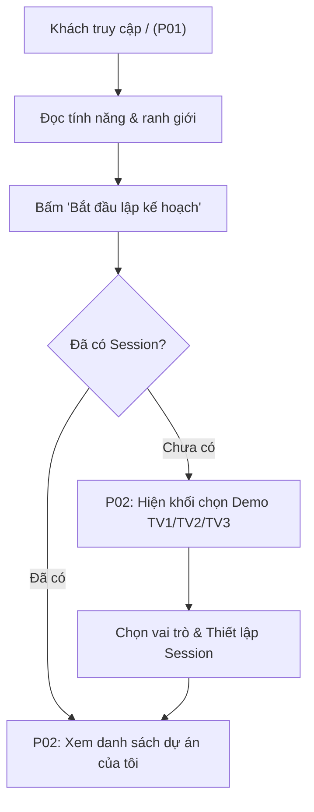
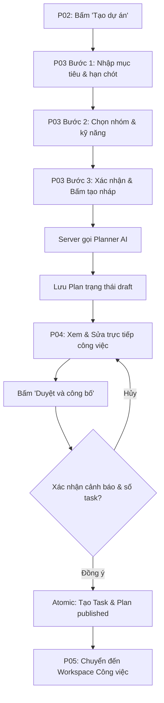
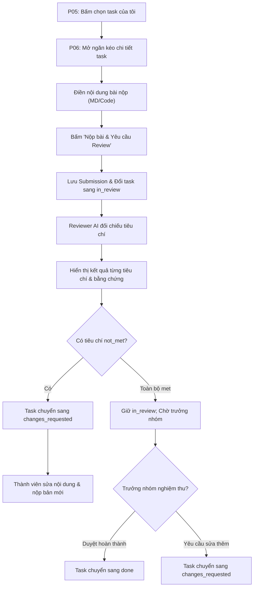
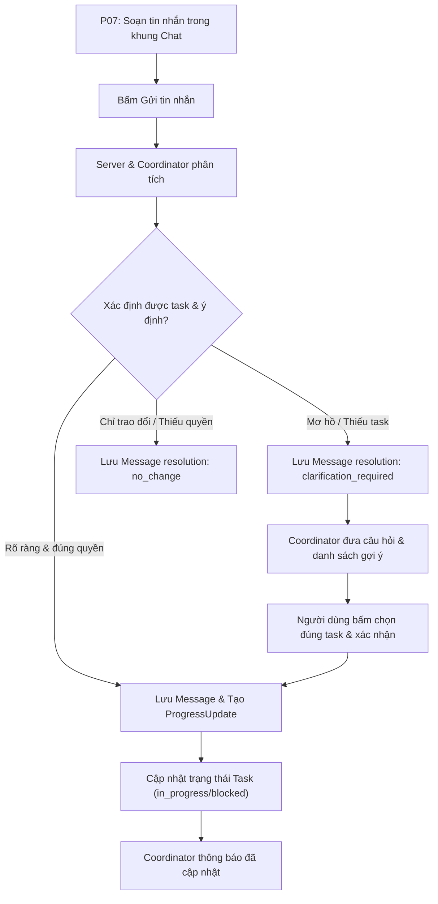
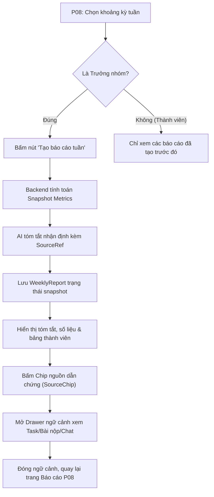
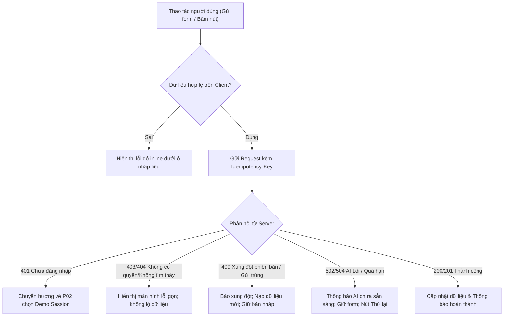

# Kiến Trúc Trang và Luồng Thao Tác (Sitemap & Flows) — TeamFlow AI

> [!IMPORTANT]
> **Tài liệu đặc tả hợp đồng điều hướng và các luồng nghiệp vụ cốt lõi.**
> Mọi đường dẫn route trong tài liệu này là quy ước đề xuất cho phiên triển khai. Không tạo thêm các trang ngoài danh mục (không thêm trang auth/pricing/settings riêng). Các luồng nghiệp vụ bảo đảm tính nhất quán với [CONTRACTS](../CONTRACTS.md) và [PROJECT_RULES](../PROJECT_RULES.md).

---

## 1. Bảng Kiến Trúc Trang và Phân Quyền (Sitemap Matrix)

| ID Trang | Tuyến Route Đề Xuất | Mục Đích Sử Dụng | Quyền Hạn Hợp Lệ | Nguồn Dữ Liệu API Dự Kiến | Điểm Vào (Entry) | Điểm Ra (Exit) | Chủ Quản (Owner) | Mức Độ MVP |
|---|---|---|---|---|---|---|---|---|
| **P01** | `/` | **Landing Page**: Giới thiệu giải pháp điều phối, ba trợ lý AI và ranh giới kiểm soát thực tế. | Công khai (Khách, Thành viên, Trưởng nhóm) | Tĩnh (Static content) | Trực tiếp từ URL trình duyệt | Bấm "Bắt đầu lập kế hoạch" → P02; Bấm anchor link nội trang | **TV1** | **P0** (Bắt buộc) |
| **P02** | `/app` | **Danh sách Dự án & Điểm vào Demo**: Xem các dự án đã tham gia; chọn session demo nếu chưa đăng nhập. | Mọi người dùng có session hợp lệ; Khách chọn vai trò demo | `GET /api/session` `GET /api/projects` | Từ P01 hoặc thanh điều hướng Topbar | Bấm "Tạo dự án" → P03; Bấm chọn dự án → P05; Bấm tiếp tục nháp → P04 | **TV2** | **P0** (Bắt buộc) |
| **P03** | `/app/projects/new` | **Tạo Dự Án (Wizard 3 bước)**: Nhập thông tin mục tiêu, cấu hình thành viên nhóm và khởi tạo bản kế hoạch nháp. | Người dùng có session (Tự động trở thành `leader` của dự án) | `GET /api/users` `POST /api/projects` `POST /api/projects/:id/members` `POST /api/projects/:id/plan` | Từ nút "Tạo dự án" tại P02 | Hoàn thành Wizard → P04; Hủy bỏ → P02 | **TV1** | **P0** (Bắt buộc) |
| **P04** | `/app/projects/:projectId/plan` | **Xem, Sửa & Duyệt Kế Hoạch**: Trưởng nhóm xem/sửa trực tiếp task nháp của Planner, duyệt và công bố chính thức. | - Trưởng nhóm (`leader`): Sửa, duyệt, công bố. - Thành viên (`member`): Chỉ đọc khi đã `published`. | `GET /api/projects/:id/plan` `PUT /api/plans/:id/draft` `POST /api/plans/:id/publish` | Từ bước 3 của P03 hoặc Tab "Kế hoạch" tại P05 | Công bố thành công → P05; Quay lại danh sách → P02 | **TV1** | **P0** (Bắt buộc) |
| **P05** | `/app/projects/:projectId/tasks` | **Không Gian Công Việc (Workspace)**: Tóm tắt 4 chỉ số dự án, bảng danh sách công việc, lọc và tìm kiếm task. | Thành viên thuộc dự án (`leader` hoặc `member`) | `GET /api/projects/:id` `GET /api/projects/:id/tasks` | Từ P02 hoặc sau khi công bố tại P04 | Bấm vào dòng task → mở P06; Chuyển Tab → P04, P07, P08 | **TV2** | **P0** (Bắt buộc) |
| **P06** | `/app/projects/:projectId/tasks/:taskId` | **Chi Tiết Công Việc & Nghiệm Thu**: Xem tiêu chí, lịch sử cập nhật; nộp bài; nhận xét AI Review; nghiệm thu hoàn thành. | - Mọi thành viên: Xem chi tiết. - Phụ trách/Leader: Nộp bài/cập nhật. - Leader/`canAccept`: Nghiệm thu. | `GET /api/tasks/:id` `POST /api/tasks/:id/submissions` `POST /api/submissions/:id/review` `POST /api/tasks/:id/accept` | Nhấp chọn dòng task từ P05 hoặc liên kết từ P07, P08 | Đóng ngăn kéo/quay lại → P05 | **TV2** (Khung Drawer) **TV3** (Form Nộp & Review) | **P0** (Bắt buộc) |
| **P07** | `/app/projects/:projectId/chat` | **Kênh Trao Đổi & Cập Nhật (Coordinator)**: Trò chuyện nhóm; Coordinator bóc tách tiến độ/trở ngại hoặc hỏi lại nếu mơ hồ. | Thành viên thuộc dự án (`leader` hoặc `member`) | `GET /api/projects/:id/messages` `POST /api/projects/:id/messages` `POST /api/messages/:id/resolve` | Bấm Tab "Chat" từ Topbar hoặc thanh điều hướng | Bấm chip công việc → mở P06; Chuyển Tab → P05 | **TV2** | **P0** (Bắt buộc) |
| **P08** | `/app/projects/:projectId/reports` | **Báo Cáo Tiến Độ Tuần**: Xem số liệu snapshot và các nhận định có nguồn; Trưởng nhóm kích hoạt tạo báo cáo mới bằng nút. | - Thành viên: Xem báo cáo đã tạo. - Trưởng nhóm: Bấm tạo báo cáo tuần mới. | `GET /api/projects/:id/reports` `POST /api/projects/:id/reports` `GET /api/reports/:id` | Bấm Tab "Báo cáo" từ thanh điều hướng | Bấm liên kết nguồn → mở P06/P07; Quay lại Tab → P05 | **TV3** | **P0** (Bắt buộc) |

---

## 2. Quy Tắc Kiến Trúc Tối Giản Để Kịp 4 Giờ

1. **Hiển thị P06 linh hoạt (Desktop Drawer / Mobile Page)**:
   - Trên Desktop (≥ 1024px): P06 hiển thị dạng **Ngăn kéo bên phải (Slide-over Drawer)** đè lên P05 để người dùng không mất ngữ cảnh danh sách.
   - Trên Mobile (< 768px): P06 hiển thị toàn màn hình (Full page view) với nút bấm quay lại danh sách trên thanh tiêu đề.
   - Cả hai chế độ đều chia sẻ chung một component logic và hỗ trợ đường dẫn sâu (Deep link URL: `/app/projects/:projectId/tasks/:taskId`).
2. **Không tạo trang Báo cáo chi tiết độc lập**:
   - Toàn bộ nội dung xem báo cáo chi tiết, số liệu metrics và danh sách nguồn được hiển thị trực tiếp tại P08 thông qua bộ chọn kỳ tuần (Dropdown/Tabs).
3. **Không tạo trang Quản trị thành viên độc lập**:
   - Thiết lập thành viên được thực hiện tại Bước 2 của Wizard P03. Trong P05, thông tin thành viên được hiển thị gọn ở thanh phụ hoặc modal xem nhanh.
4. **Không tạo trang Đăng nhập phức tạp**:
   - Khi chưa phát hiện session người dùng, một khối nhỏ "Chọn tài khoản Demo" (TV1 / TV2 / TV3) xuất hiện ngay đầu trang P02.

---

## 3. Các Luồng Thao Tác Cốt Lõi (Core User Flows)

### F01. Khách từ Landing Page vào Ứng Dụng (Landing to App & Demo Entry)

| Thuộc tính luồng | Chi tiết đặc tả |
|---|---|
| **Tác nhân (Actor)** | Khách vãng lai, Giám khảo, Thành viên nhóm demo. |
| **Tiền điều kiện** | Truy cập đường dẫn gốc `/` trên trình duyệt web. |
| **Hành động kích hoạt** | Nhấp chuột vào nút Primary CTA "Bắt đầu lập kế hoạch" trên Hero hoặc Header của P01. |
| **Trang điều hướng** | `P01 (/)` → `P02 (/app)`. |
| **Thay đổi dữ liệu** | Tạo phiên làm việc `Session` với tài khoản demo được chọn (nếu chưa đăng nhập). |
| **Kết quả thành công** | Chuyển đến màn hình P02 hiển thị danh sách các dự án người dùng đang tham gia. |
| **Xử lý khi lỗi / Thử lại** | Nếu khởi tạo session demo thất bại, hiển thị thông báo lỗi inline tại P02 và giữ nút thử lại. |
| **Điểm phê duyệt** | Con người tự tay nhấp chọn danh tính demo trên giao diện. |

---

### F02. Trưởng Nhóm Tạo Dự Án, Sửa và Công Bố Kế Hoạch (Project Planning & Publish)

| Thuộc tính luồng | Chi tiết đặc tả |
|---|---|
| **Tác nhân (Actor)** | Trưởng nhóm (`leader`). |
| **Tiền điều kiện** | Đã có session hợp lệ; đang ở trang P02. |
| **Hành động kích hoạt** | Nhấp nút "Tạo dự án" tại P02; điền Wizard 3 bước; duyệt bản nháp tại P04. |
| **Trang điều hướng** | `P02 (/app)` → `P03 (/app/projects/new)` → `P04 (/app/projects/:id/plan)` → `P05 (/app/projects/:id/tasks)`. |
| **Thay đổi dữ liệu** | Tạo Project mới → Thêm ProjectMember → Tạo Plan nháp (`draftTasks`) → Chuyển Plan sang `published` và tạo các bản ghi `Task` chính thức trong cơ sở dữ liệu. |
| **Kết quả thành công** | Toàn bộ công việc chính thức xuất hiện trên bảng P05 với trạng thái ban đầu `todo`. |
| **Xử lý khi lỗi / Thử lại** | - Nếu AI Planner lỗi/timeout: Giữ nguyên form tại Bước 3, hiển thị thông báo lỗi và cho phép bấm "Thử lại". - Khi Publish: Gửi kèm `Idempotency-Key` để tránh tạo trùng lặp task khi mạng chập chờn. |
| **Điểm phê duyệt** | **Trưởng nhóm bắt buộc kiểm tra và bấm nút "Duyệt và công bố"**. AI tuyệt đối không tự công bố. |

---

### F03. Thành Viên Cập Nhật, Nộp Bài, Nhận Review và Nghiệm Thu (Delivery & Review)

| Thuộc tính luồng | Chi tiết đặc tả |
|---|---|
| **Tác nhân (Actor)** | Người phụ trách công việc (`assignee`) và Trưởng nhóm / Người nghiệm thu (`canAccept`). |
| **Tiền điều kiện** | Task đang ở trạng thái khác `done`. |
| **Hành động kích hoạt** | Người phụ trách dán nội dung bài nộp và bấm "Nộp bài & Yêu cầu Review". |
| **Trang điều hướng** | Thực hiện trực tiếp trên ngăn kéo `P06` (trên nền P05). |
| **Thay đổi dữ liệu** | Tạo bản ghi `Submission` (tăng số revision) → Chuyển task sang `in_review` → Tạo bản ghi `Review` lưu kết quả từng tiêu chí (`met`, `not_met`, `insufficient_evidence`) → Chuyển task sang `done` khi được nghiệm thu. |
| **Kết quả thành công** | Bài nộp được lưu trữ; kết quả review hiển thị rõ ràng từng tiêu chí; task được nghiệm thu `done` có lưu `acceptedAt` và `acceptedByMemberId`. |
| **Xử lý khi lỗi / Thử lại** | - Nộp lại không ghi đè bài cũ, tạo một revision mới giữ nguyên lịch sử. - Khi AI Review lỗi, task vẫn giữ ở `in_review`, cho phép bấm "Yêu cầu phân tích lại". |
| **Điểm phê duyệt** | **Con người (Trưởng nhóm hoặc người có quyền nghiệm thu) bấm nút "Xác nhận hoàn thành"**. AI không có quyền tự chuyển trạng thái task sang `done`. |

---

### F04. Trao Đổi Qua Chat: Phân Biệt Rõ Ý và Mơ Hồ (Chat & Coordination)

| Thuộc tính luồng | Chi tiết đặc tả |
|---|---|
| **Tác nhân (Actor)** | Thành viên trong dự án. |
| **Tiền điều kiện** | Đang ở màn hình P07; dự án đã công bố công việc. |
| **Hành động kích hoạt** | Nhập nội dung vào ô soạn thảo và bấm nút "Gửi" (hoặc bấm `Enter`). |
| **Trang điều hướng** | Thực hiện tại `P07 (/app/projects/:projectId/chat)`. |
| **Thay đổi dữ liệu** | Tạo bản ghi `Message`; nếu rõ ràng và đúng quyền thì tạo `ProgressUpdate` và cập nhật trạng thái `Task` tương ứng. |
| **Kết quả thành công** | Tin nhắn hiển thị trên khung chat; Coordinator phản hồi xác nhận nội dung thay đổi hoặc đặt câu hỏi làm rõ. |
| **Xử lý khi lỗi / Thử lại** | Nếu gửi tin nhắn thất bại do mất mạng hoặc AI lỗi, tin nhắn được giữ lại trong ô soạn thảo kèm thông báo lỗi và nút bấm "Gửi lại". |
| **Điểm phê duyệt** | Khi tin nhắn mơ hồ, **người dùng tự chọn đúng công việc từ danh sách gợi ý**, Coordinator không tự ý suy đoán gán bừa. |

---

### F05. Tạo và Xem Báo Cáo Tuần Kèm Dẫn Chứng (Weekly Report & Sources)

| Thuộc tính luồng | Chi tiết đặc tả |
|---|---|
| **Tác nhân (Actor)** | Trưởng nhóm (tạo báo cáo) / Mọi thành viên (xem báo cáo). |
| **Tiền điều kiện** | Đang ở màn hình P08 của dự án. |
| **Hành động kích hoạt** | Trưởng nhóm chọn khoảng thời gian và bấm nút "Tạo báo cáo tuần". |
| **Trang điều hướng** | Thực hiện tại `P08 (/app/projects/:projectId/reports)`. |
| **Thay đổi dữ liệu** | Tạo bản ghi `WeeklyReport` chứa snapshot số liệu (`ReportMetrics`), danh sách nguồn (`sourceRefs`) và tóm tắt (`summary`). |
| **Kết quả thành công** | Báo cáo hiển thị đầy đủ thời điểm chụp dữ liệu (`asOf`), các chỉ số khách quan do backend tính và bảng hoạt động từng cá nhân. |
| **Xử lý khi lỗi / Thử lại** | Nếu AI tóm tắt thất bại, số liệu backend đã tính vẫn được bảo lưu, hiển thị nút "Thử tạo lại tóm tắt". |
| **Điểm phê duyệt** | **Báo cáo chỉ được tạo khi con người chủ động bấm nút**, không tự động chạy ngầm theo lịch trình. |

---

### F06. Xử Lý Các Ngoại Lệ Toàn Cục (Global Exception Handling)

| Tình huống ngoại lệ | Trải nghiệm giao diện & Cách xử lý |
|---|---|
| **Chưa có dữ liệu (Empty State)** | Hiển thị thông báo trung tính với hình minh họa nét viền và câu hướng dẫn hành động cụ thể theo đúng vai trò (ví dụ: Trưởng nhóm thấy nút tạo; thành viên thấy thông báo chờ). |
| **Không có quyền truy cập (Denied / 403 / 404)** | Hiển thị màn hình lỗi trang nhã: "Bạn không có quyền truy cập hoặc tài nguyên không tồn tại". Tuyệt đối không để lộ tiêu đề hoặc dữ liệu nhạy cảm của dự án khác. Có nút quay về Trang danh sách dự án P02. |
| **Lỗi AI không phản hồi (502 / 504)** | Không để lại dữ liệu cập nhật nửa vời. Giữ nguyên nội dung người dùng vừa nhập trong form, hiển thị thông báo lỗi rõ ràng và cung cấp nút bấm "Thử lại". |
| **Dữ liệu chưa lưu khi rời trang (Unsaved Changes)** | Khi người dùng đang soạn thảo (trong form tạo dự án P03, sửa kế hoạch P04, hoặc nộp bài P06) mà bấm nút thoát, hiển thị hộp thoại xác nhận: *"Bạn có thay đổi chưa lưu. Bạn có chắc chắn muốn rời đi?"*. |
| **Chống bấm lặp / Gửi trùng (Duplicate Submission)** | Vô hiệu hóa nút bấm ngay khi bắt đầu gửi (trạng thái pending); gửi kèm header `Idempotency-Key` duy nhất để server ngăn chặn tạo bản ghi trùng lặp. |
